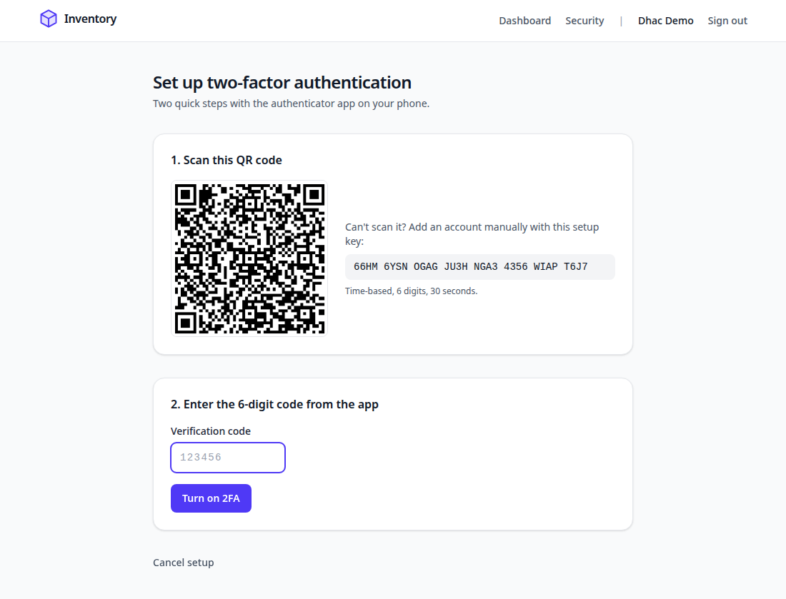
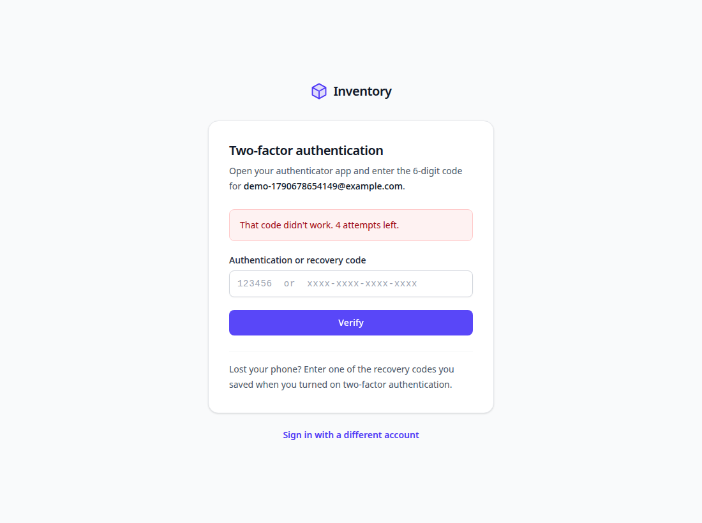
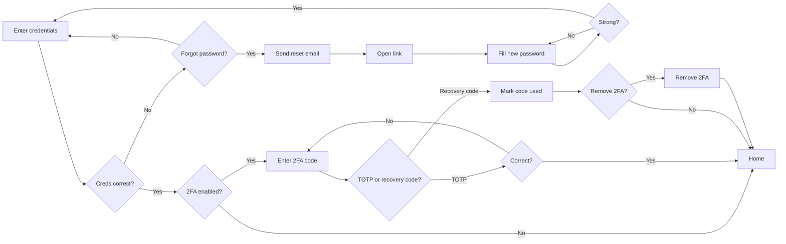

# Inventory Management System

Phase one: secure authentication. Email + password sign-in, TOTP two-factor authentication with
one-time recovery codes, and password reset by email.

**Stack:** Next.js 16 (App Router, Server Actions) · Prisma 7 · PostgreSQL 18 · Tailwind CSS 4 ·
Podman containers · GitHub Actions CI/CD.

| Sign up (live strength meter) | 2FA setup | Second step at sign-in |
| --- | --- | --- |
|  |  |  |

## The flow



| Flowchart step | Route | Server logic |
| --- | --- | --- |
| User enters credentials | `/login` | `login` in `src/app/actions/auth.ts` |
| Forgot password → send reset email | `/forgot-password` | `requestPasswordReset` in `src/app/actions/password-reset.ts` |
| Fill new password → strong? | `/reset-password?token=…` | `resetPasswordWithToken` in `src/lib/auth/password-reset.ts` |
| Enter 2FA (TOTP or recovery code) | `/login/two-factor` | `verifySecondFactor` in `src/lib/auth/two-factor.ts` |
| Recovery code used → remove 2FA? | `/login/recovery-used` | `removeTwoFactorAfterRecovery` in `src/app/actions/two-factor.ts` |
| Home page | `/` | `requireUser` in `src/lib/auth/dal.ts` |
| (extra) Sign up | `/signup` | `registerUser` in `src/lib/auth/users.ts` |
| (extra) Turn 2FA on/off, new recovery codes | `/settings/security` | `src/app/actions/two-factor.ts` |

## Setup on a fresh Fedora machine

```bash
# 1. System tools
sudo dnf install -y git nodejs24 nodejs24-npm podman podman-compose

# 2. Dependencies (also generates the Prisma client)
cd ~/Projects/inventory-management-system
npm install

# 3. Configuration: copy the template, then fill in the generated secrets
cp .env.example .env
openssl rand -base64 32   # → ENCRYPTION_KEY
openssl rand -hex 16      # → POSTGRES_PASSWORD (and inside DATABASE_URL / TEST_DATABASE_URL)

# 4. Start PostgreSQL + Mailpit (a local inbox for test emails)
npm run services:up

# 5. Create the tables
npm run db:migrate

# 6. Run the app
npm run dev
```

- App: http://localhost:3000
- Emails (password resets): http://localhost:8025
- Database browser: `npm run db:studio`

## Everyday commands

| Command | What it does |
| --- | --- |
| `npm run dev` | Dev server with hot reload |
| `npm run services:up` / `services:down` | Start / stop PostgreSQL and Mailpit containers |
| `npm run db:migrate -- --name <change>` | After editing `prisma/schema.prisma`: create + apply a migration |
| `npm run lint` · `npm run typecheck` | ESLint · TypeScript |
| `npm test` | Unit + integration tests (uses a separate `*_test` database) |
| `npm run test:e2e` | Browser test of the whole flow. First run `npx playwright install chromium --only-shell` and `npm run build` |

## Run everything in containers

Production-like: migrations run once in their own container, then the app starts as a non-root
standalone Node.js server.

```bash
podman compose --profile app up -d --build
podman compose ps              # app should be "healthy"
curl localhost:3000/api/health
podman compose --profile app down   # stop (data stays in the pgdata volume)
```

## Using a real email provider

Replace the SMTP block in `.env`. Example for Gmail (needs 2-Step Verification and an
[app password](https://myaccount.google.com/apppasswords)):

```bash
SMTP_HOST=smtp.gmail.com
SMTP_PORT=465
SMTP_SECURE=true
SMTP_USER=you@gmail.com
SMTP_PASSWORD=your-16-char-app-password
MAIL_FROM="Inventory <you@gmail.com>"
CONTAINER_SMTP_HOST=smtp.gmail.com
```

Resend, Brevo, Mailgun and Amazon SES work the same way with their SMTP settings.

## CI/CD (GitHub Actions)

`.github/workflows/ci.yml` runs on every push and pull request:

1. **verify**: lint, typecheck, unit + integration tests, build, and the Playwright end-to-end
   test against real PostgreSQL and Mailpit service containers.
2. **image**: builds the `runner` and `migrator` images. On `main` they are pushed to GitHub
   Container Registry as `ghcr.io/<owner>/<repo>` and `ghcr.io/<owner>/<repo>-migrator`
   (tags: `latest` and `sha-…`).

Dependabot (`.github/dependabot.yml`) opens weekly update PRs for npm packages, GitHub Actions and
base images.

To deploy: run the migrator image once, then the app image, with the environment variables from
`.env.example` (`APP_URL` must be your `https://` URL so cookies are marked `Secure`).

## Security design

- **Passwords:** argon2id (19 MiB, 2 iterations). Strength checked with zxcvbn (score ≥ 3,
  ≥ 10 characters, the user's name/email count against it) in the browser *and* on the server.
- **Sessions:** 256-bit random token in an `HttpOnly`, `SameSite=Lax` cookie; the database stores
  only its SHA-256. 30-day sliding expiry. A session that has passed the password but not 2FA
  expires after 10 minutes and allows 5 code attempts.
- **TOTP:** RFC 6238 (SHA-1, 6 digits, 30 s, ±1 step drift). Secrets encrypted at rest with
  AES-256-GCM (`ENCRYPTION_KEY`). A code can't be reused (replay protection).
- **Recovery codes:** 10 codes, about 79 bits each, stored hashed, each works once (atomic update).
- **Password reset:** single-use token (hashed in the database), valid for 30 minutes. The response
  is identical whether or not the email exists, and the email is sent after the response so timing
  gives nothing away. A successful reset signs out every session.
- **Other:** rate limits on sign-in, sign-up, reset and re-authentication (in memory: move to
  Redis/Postgres before running more than one app instance); security headers; timing-safe login
  for unknown emails; removing 2FA signs out other sessions.

## Project layout

```
prisma/schema.prisma        Database models (users, sessions, recovery_codes, password_reset_tokens)
src/app/(auth)/             Sign-in, 2FA, recovery, sign-up, forgot/reset password pages
src/app/(app)/              Signed-in area: dashboard, security settings
src/app/actions/            Server Actions (form handlers)
src/lib/auth/               Sessions, users, 2FA, password reset (no Next.js APIs, so easy to test)
src/lib/                    Crypto, TOTP, recovery codes, password rules, mail, env validation
src/proxy.ts                Redirects visitors without a session cookie to /login
tests/                      Vitest unit + integration tests
e2e/                        Playwright browser test of the full flow
compose.yaml · Dockerfile   Containers
```
