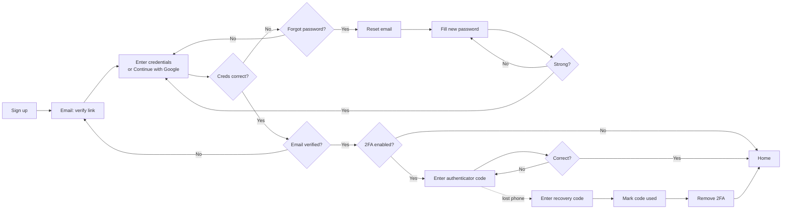

# Inventory Management System

Phase one: secure authentication. Email + password with **email verification**, **Google
sign-in**, **TOTP two-factor authentication** with recovery codes, and **password reset by
email**.

**Stack:** Next.js 16 (App Router, Server Actions) · Prisma 7 · PostgreSQL 18 · Tailwind CSS 4 ·
Podman containers · Nginx + Certbot (Let's Encrypt HTTPS) · GitHub Actions CI/CD.

> 📘 **New here, or not a developer?** Start with the **[Phase One Handbook](docs/README.md)**. It covers
> every command from a fresh Fedora install, how each flow works, the technologies, Prisma and the
> database, containers and storage, networking/domains/HTTPS, configuration, operations, making
> changes, testing, and troubleshooting.

| Sign up | Verification email | 2FA at sign-in | Lost phone |
| --- | --- | --- | --- |
|  |  |  |  |

## The flow



- The sign-in step accepts **only the 6-digit authenticator code**.
- **Recovery codes only turn 2FA off**, either when the phone is lost (the "Use a recovery code"
  link) or from Security settings.
- Google proves the email address, not the second factor: 2FA users still enter their code.

| Step | Route | Server logic |
| --- | --- | --- |
| Sign up → verification email | `/signup` | `signup` in `src/app/actions/auth.ts` |
| Verify email (button, not a bare link) | `/verify-email?token=…` | `src/lib/auth/email-verification.ts` |
| Enter credentials | `/login` | `login` in `src/app/actions/auth.ts` |
| Continue with Google | `/api/auth/google` → `/callback` | `src/lib/auth/google.ts`, `google-accounts.ts` |
| Forgot password → reset | `/forgot-password`, `/reset-password?token=…` | `src/lib/auth/password-reset.ts` |
| Authenticator code | `/login/two-factor` | `verifyAuthenticatorCode` in `src/lib/auth/two-factor.ts` |
| Recovery code → remove 2FA | `/login/recovery` | `disableTwoFactorWithRecoveryCode` in `src/lib/auth/two-factor.ts` |
| 2FA setup, new codes, turn off | `/settings/security` | `src/app/actions/two-factor.ts` |

---

## Production: hand over the folder, run one command

The app container is **stateless**. Sessions, rate-limit counters, tokens and users all live in
PostgreSQL, and PostgreSQL's files live in a **host folder you choose** (`POSTGRES_DATA_DIR`).
Containers can be rebuilt, restarted or deleted without losing anything.

**On the target machine** (only Podman is needed; Node.js is not):

```bash
sudo dnf install -y podman podman-compose      # Fedora/RHEL. Debian/Ubuntu: apt install podman podman-compose

cd inventory-management-system                # the handed-over folder, or: git clone …
./scripts/init-env.sh                          # creates .env with a fresh DB password + encryption key
nano .env                                      # set APP_URL, SMTP_*, MAIL_FROM, POSTGRES_DATA_DIR (see below)

podman compose up -d --build                   # build images, migrate the database, start the app
podman compose ps                              # app should become "healthy"
```

What `up` does:

1. Builds the images (all npm dependencies are installed *inside* the image).
2. Starts PostgreSQL with its data in `POSTGRES_DATA_DIR` (created on first start).
3. Runs the `migrate` job once (`prisma migrate deploy`).
4. Starts the app. The app itself waits until every migration in its image is applied before
   serving, so it never runs against an old schema.

Settings that matter for production (`.env`):

| Variable | Example | Notes |
| --- | --- | --- |
| `APP_URL` | `https://inventory.example.com` | Used in email links; `https://` makes cookies `Secure` |
| `POSTGRES_DATA_DIR` | `/srv/inventory/postgres` or `./data/postgres` | Must be writable by the user running Podman |
| `SMTP_*`, `MAIL_FROM` | see [Email](#email-delivery) | Mailpit is only for development |
| `ENCRYPTION_KEY` | generated | **Back it up.** Losing or changing it breaks every enrolled authenticator |
| `APP_BIND` | `127.0.0.1` | `0.0.0.0` exposes plain HTTP on your network; keep `127.0.0.1` with HTTPS |
| `GOOGLE_CLIENT_ID/SECRET` | optional | see [Google sign-in](#google-sign-in) |

### HTTPS with your domain

Point your domain's DNS at the server, then:

```bash
# .env:  DOMAIN=inventory.example.com   APP_URL=https://inventory.example.com
#        LETSENCRYPT_EMAIL=you@example.com (optional)
sudo sysctl -w net.ipv4.ip_unprivileged_port_start=80                 # lets rootless Podman use 80/443
echo 'net.ipv4.ip_unprivileged_port_start=80' | sudo tee /etc/sysctl.d/50-unprivileged-ports.conf
podman compose --profile https up -d --build
podman compose --profile https logs -f certbot                        # watch the certificate being issued
```

Two containers handle HTTPS. **Nginx** sits in front of the app, redirects HTTP to HTTPS and adds
HSTS. **Certbot** gets the Let's Encrypt certificate, then checks twice a day and renews it when it
has fewer than 30 days left. Nginx switches from its temporary HTTP-only mode to HTTPS by itself once
the certificate exists. Open ports 80 and 443 in your firewall (`sudo firewall-cmd --add-service={http,https} --permanent && sudo firewall-cmd --reload`).

### Start automatically after a reboot

Rootless containers need two one-time commands:

```bash
sudo loginctl enable-linger "$USER"                  # run your containers without being logged in
systemctl --user enable --now podman-restart.service # restart containers marked restart: always
```

### Updates, backups, moving machines

```bash
git pull && podman compose up -d --build             # update: new images, pending migrations run automatically
./scripts/backup-db.sh                                # → backups/inventory-<timestamp>.dump (safe while running)
./scripts/restore-db.sh backups/inventory-….dump      # replace the database with a dump (asks for confirmation)
```

Schedule backups with cron or a systemd timer, and copy `backups/` and `.env` off the machine.
The files in `POSTGRES_DATA_DIR` belong to the container's `postgres` user, so move data between
machines with backup → restore rather than copying the folder. To delete the folder, run
`podman unshare rm -rf <dir>`.

---

## Email delivery

The app sends every email itself. It uses [Nodemailer](https://nodemailer.com) (open source) and
one shared HTML + plain-text template (`src/lib/mail.ts`, `src/lib/emails.ts`):

- Verify your email ("click here to activate")
- Reset your password ("click here to choose a new password")
- You already have an account (sent instead of revealing that an email is registered)
- Security notices: password changed, 2FA turned off, Google connected

All links are single-use, stored only as hashes, and expire (24 h for verification, 30 min for
resets). What you need to choose is **who delivers the mail** over SMTP:

| Option | Open source? | Cost | Good for |
| --- | --- | --- | --- |
| [Mailpit](https://mailpit.axllent.org) (included, `--profile dev`) | ✅ | free | Development only: catches all mail at http://localhost:8025 |
| [Brevo](https://www.brevo.com), [Resend](https://resend.com), [Amazon SES](https://aws.amazon.com/ses/) | ❌ (hosted) | free tiers / cents | **Production (recommended)**: good inbox placement with no mail-server upkeep |
| Gmail + [app password](https://myaccount.google.com/apppasswords) | ❌ | free | Personal/small use (about 500 emails per day) |
| Self-hosted: [Stalwart](https://stalw.art), [Postal](https://docs.postalserver.io), [docker-mailserver](https://docker-mailserver.github.io/docker-mailserver/latest/) | ✅ | a server | Full control, but you must run a mail server (see below) |

Whichever you choose, mail is treated as **authentic** (not spam) only when your domain publishes
**SPF**, **DKIM** and **DMARC** DNS records for the sender. Hosted providers walk you through adding
them. Self-hosting also needs a static IP with reverse DNS and open port 25, which most home and
cloud connections block.

Example (Gmail):

```bash
SMTP_HOST=smtp.gmail.com
SMTP_PORT=465
SMTP_SECURE=true
SMTP_USER=you@gmail.com
SMTP_PASSWORD=your-16-char-app-password
MAIL_FROM="Inventory <you@gmail.com>"
```

## Google sign-in

1. [Google Cloud console](https://console.cloud.google.com/apis/credentials) → **Create credentials →
   OAuth client ID** → *Web application* (configure the consent screen first if asked).
2. **Authorized redirect URI:** `<APP_URL>/api/auth/google/callback`, for example
   `http://localhost:3000/api/auth/google/callback` for development or
   `https://inventory.example.com/api/auth/google/callback` for production. Google accepts plain
   `http://` only for `localhost`.
3. Put the client ID and secret in `.env` (`GOOGLE_CLIENT_ID`, `GOOGLE_CLIENT_SECRET`) and restart.
   The "Continue with Google" button appears automatically.

How accounts are matched: Google's stable account id (`sub`) identifies returning users. A first
Google sign-in links to an existing account with the same email only when Google has verified that
email. If the local account was never verified, its password is removed during linking, because
whoever set it never proved they own the address.

---

## Development on Fedora

```bash
sudo dnf install -y git nodejs24 nodejs24-npm podman podman-compose
npm install                     # also generates the Prisma client
./scripts/init-env.sh           # .env with secrets; the defaults point at the dev containers
npm run services:up             # PostgreSQL + Mailpit
npm run db:migrate              # create/upgrade tables
npm run dev                     # http://localhost:3000 · emails: http://localhost:8025
```

| Command | What it does |
| --- | --- |
| `npm run dev` | Dev server with hot reload |
| `npm run services:up` / `services:down` | Start / stop the dev containers |
| `npm run db:migrate -- --name <change>` | After editing `prisma/schema.prisma`: create and apply a migration |
| `npm run db:studio` | Browse the database |
| `npm run lint` · `npm run typecheck` | ESLint · TypeScript |
| `npm test` | Unit + integration tests (separate `*_test` database) |
| `npm run test:e2e` | Browser test of every flow, reading emails from Mailpit (first: `npx playwright install chromium --only-shell` and `npm run build`) |

To run the production containers locally: `podman compose --profile dev up -d --build`, with
`CONTAINER_SMTP_HOST=mailpit` in `.env` so the app container can reach the dev inbox.

## CI/CD (GitHub Actions)

`.github/workflows/ci.yml` runs on every push and pull request:

1. **verify**: lint, typecheck, unit + integration tests, build, and the Playwright end-to-end
   test against real PostgreSQL and Mailpit service containers.
2. **image**: builds the `runner` and `migrator` images. On `main` they are pushed to
   `ghcr.io/<owner>/<repo>` and `ghcr.io/<owner>/<repo>-migrator` (tags `latest`, `sha-…`).

Dependabot opens weekly update PRs for npm packages, GitHub Actions and base images.

## Security design

- **Passwords:** argon2id (19 MiB, 2 iterations). Strength is checked with zxcvbn (score ≥ 3, at
  least 10 characters; your own name and email count against you) in the browser *and* on the
  server.
- **Accounts can't be discovered:** sign-up and forgot-password give the same answer whether or not
  an email is registered (the owner gets an email instead), emails are sent after the response, and
  logins for unknown emails still pay the hashing cost.
- **Email verification:** required before the first sign-in. The link opens a confirm button, so
  mail scanners that pre-fetch links can't verify an address. Re-registering an unverified email
  replaces the earlier attempt, which blocks "pre-registering" someone else's address.
- **Sessions:** 256-bit random token in an `HttpOnly`, `SameSite=Lax` cookie; the database stores
  only its SHA-256. 30-day sliding expiry. After the password step, a session has 10 minutes and 5
  attempts to pass 2FA.
- **TOTP:** RFC 6238 (SHA-1, 6 digits, 30 s, ±1 step). Secrets are encrypted at rest with
  AES-256-GCM, and a used code can't be replayed.
- **Recovery codes:** 10 codes of about 79 bits each, stored hashed, single use, and their only
  purpose is turning 2FA off. Turning 2FA off signs out other sessions and sends an email.
- **Google:** OpenID Connect Authorization Code flow with PKCE, state and nonce. The ID token's
  issuer, audience, expiry and nonce are validated, and only verified emails are linked.
- **Rate limits** in PostgreSQL (shared by all instances) on sign-in, sign-up, verification and
  reset emails, and 2FA changes. Security headers everywhere, plus HSTS behind Nginx.

## Project layout

```
prisma/schema.prisma        Models: users, sessions, oauth_accounts, recovery_codes, tokens, rate_limits
src/app/(auth)/             Sign-in, 2FA, recovery, sign-up, verify-email, forgot/reset password
src/app/(app)/              Signed-in area: dashboard, security settings
src/app/actions/            Server Actions (form handlers)
src/app/api/auth/google/    Google OAuth redirect + callback
src/lib/auth/               Sessions, users, 2FA, email verification, reset, Google (no Next.js APIs → testable)
src/lib/                    Crypto, TOTP, recovery codes, password rules, email, rate limits, env
src/proxy.ts                Redirects visitors without a session cookie to /login
docker/start.mjs            Container entrypoint: waits for migrations, then starts the server
compose.yaml · Dockerfile   Containers; deploy/nginx + deploy/certbot for HTTPS
scripts/                    init-env, backup-db, restore-db
tests/ · e2e/               Vitest unit + integration tests · Playwright browser test
```
