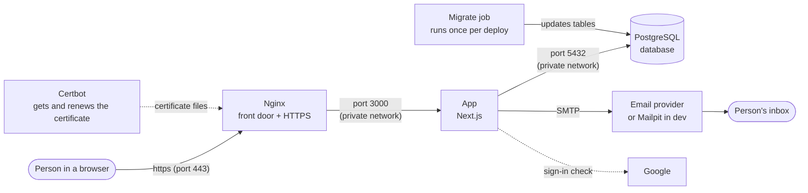

# 1. Overview and glossary

## The big picture

Think of the system as a small office building:

- **Nginx** is the **front door with a security guard**. Visitors from the internet arrive here. It
  makes sure the connection is encrypted (the padlock in the browser) and walks them to reception.
- **Certbot** is the **locksmith**. It gets the door's official lock certificate from Let's Encrypt
  and renews it before it expires.
- **The app** (Next.js) is **reception**. It shows the pages, reads the forms people fill in, and
  decides what they're allowed to see.
- **PostgreSQL** is the **locked filing cabinet**. Every account, sign-in session and one-time link
  is stored here. Only reception has the key.
- **The email service** is the **post office**. Reception hands it letters ("verify your email",
  "reset your password"), and it delivers them.
- **Google** is an **ID office in another building**. Visitors who choose "Continue with Google"
  get their identity confirmed there.

Each box except the person, Google and the email provider runs in its own **container** on the
server. [Chapter 7](07-containers-and-storage.md) explains containers; [chapter 8](08-networking-domain-https.md) explains the ports.

## What was built

| Feature | What it means for a user |
| --- | --- |
| Sign up | Enter name, email and a strong password. A live meter shows how strong it is. |
| Email verification | A "Verify your email" link is emailed. The account can't be used until it's clicked. |
| Sign in | Email + password, or the "Continue with Google" button. |
| Two-factor authentication (2FA) | Optional. After the password, a 6-digit code from a phone app (Google Authenticator, Microsoft Authenticator, Aegis…) is also required. |
| Recovery codes | 10 one-time codes shown when 2FA is turned on. If the phone is lost, one code turns 2FA off so the person can get back in. |
| Forgot password | A reset link is emailed and works once, for 30 minutes. The new password must be strong. |
| Security emails | Automatic notices when the password changes, 2FA is turned off, or Google is connected. |
| Security settings page | Turn 2FA on/off, make new recovery codes, see sign-in methods. |
| Dashboard | A welcome page. Inventory features come in phase two. |

## Design principles

1. **Stateless app.** The app container keeps nothing in memory that matters. Everything lives in the
   database, so the app can be restarted, rebuilt or even run twice without losing anything.
2. **One-command deploy.** `podman compose up -d --build` builds, updates the database and starts
   everything.
3. **Secure by default.** Industry practices from OWASP (a web-security standards group) and NIST
   (the US standards institute) are followed. [Chapter 5](05-backend-logic.md#security-summary) lists them.
4. **Tested automatically.** 48 automated checks plus a robot browser that clicks through every flow
   (see [chapter 12](12-testing-and-ci.md)).

## Glossary

| Term | Plain meaning |
| --- | --- |
| **Terminal / Konsole** | The text window where commands are typed. On Fedora KDE it's called Konsole. |
| **Command** | A line of text typed into the terminal, like `npm run dev`. |
| **Repository (repo)** | The project folder tracked by **Git**, which remembers every saved version ("commit"). |
| **GitHub** | A website that stores a copy of the repository and runs automatic checks (CI). |
| **Frontend** | What runs in the browser: the pages, buttons and forms. |
| **Backend** | What runs on the server: checking passwords, talking to the database, sending email. |
| **Next.js** | The framework the app is built with. It does both frontend and backend. |
| **Database** | Organised storage for data, in tables (like spreadsheets). Ours is **PostgreSQL**. |
| **Table / row / column** | A table is like a spreadsheet; each row is one record (e.g. one user), each column one field (e.g. email). |
| **Prisma** | A tool that lets the code talk to the database safely, and manages changes to the tables. |
| **Migration** | A saved, numbered set of changes to the database's tables (e.g. "add a column"). |
| **Container** | A sealed box that holds one program plus everything it needs, isolated from the rest of the computer. |
| **Image** | The packaged, read-only recipe a container is started from. |
| **Podman** | The program that builds images and runs containers (a secure alternative to Docker). |
| **Compose / `compose.yaml`** | One file that describes all containers and how they connect; `podman compose` reads it. |
| **Volume / bind mount** | Storage that survives when a container is deleted. A bind mount is a normal folder on the computer. |
| **Port** | A numbered door on a computer. A web browser uses 443 for HTTPS, the database 5432, etc. |
| **localhost / 127.0.0.1** | "This same computer". Something listening only on localhost can't be reached from other computers. |
| **Domain / DNS** | A name like `inventory.example.com`. DNS is the internet's phone book that turns the name into an IP address. |
| **HTTPS / TLS / certificate** | Encrypted web traffic (the padlock). It needs a **certificate** proving the domain is yours. |
| **Let's Encrypt** | A free, automatic service that issues those certificates. Certbot talks to it for us. |
| **Reverse proxy** | A program (Nginx) that receives all web traffic first and forwards it to the app. |
| **Certbot** | The official Let's Encrypt tool: requests the certificate and renews it on schedule. |
| **Environment variables / `.env`** | Settings and secrets kept outside the code, in the `.env` file. |
| **Hash** | A one-way fingerprint of data. You can check a password against its hash but can't turn the hash back into the password. |
| **Encryption** | Two-way scrambling with a key; data can be unscrambled with the same key. |
| **Session / cookie** | After signing in, the browser keeps a random ticket (cookie). The server looks it up (session) on each visit. |
| **2FA / TOTP** | Two-factor authentication using Time-based One-Time Passwords: the 6-digit codes that change every 30 seconds. |
| **OAuth / OpenID Connect (OIDC)** | The standard used by "Continue with Google" to prove who someone is without sharing their Google password. |
| **SMTP** | The standard way programs send email. |
| **Rate limit** | A cap on how often something can be tried (e.g. 10 sign-in attempts per 15 minutes), to stop guessing attacks. |
| **CI/CD** | Continuous Integration / Delivery: GitHub automatically tests every change and builds the containers. |
| **Rootless** | Podman runs containers as your normal user, not as the all-powerful `root`, which is safer. |
| **SELinux** | Fedora's built-in security guard that controls which programs may touch which files. |
