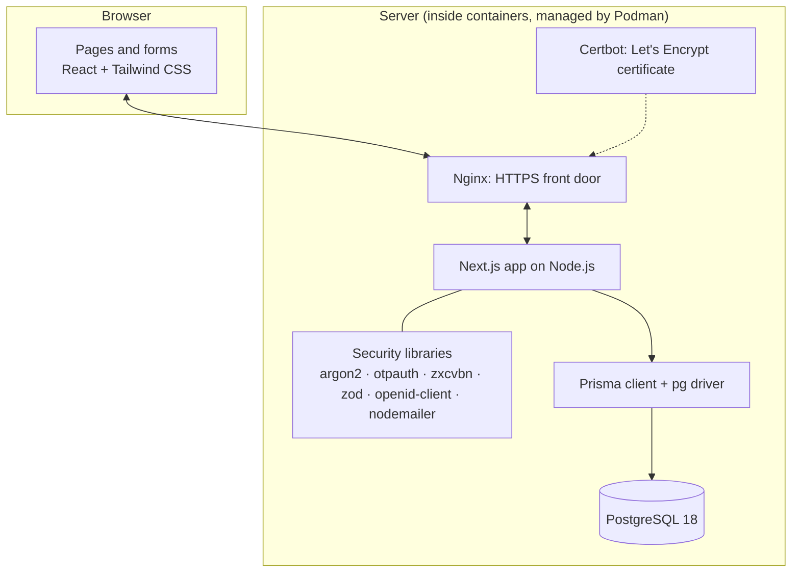

# 3. Technologies and packages

Every tool below is **free and open source**, except the hosted services you may choose for email
(Brevo, Resend, Amazon SES…) and Google itself.

## The layers

## Platform and tools on the computer

| Tool | Version | What it is | Why it was chosen |
| --- | --- | --- | --- |
| Fedora Linux | 44 (KDE) | The operating system | Your laptop's OS; also a solid server OS |
| Node.js | 24.18 LTS | Runs JavaScript outside the browser | Required by Next.js; LTS = supported for years |
| npm | 11.16 | Downloads and manages JavaScript libraries | Comes with Node.js |
| Git | 2.55 | Version control: remembers every change | Industry standard; works with GitHub |
| Podman | 5.8.7 | Builds images and runs containers | Built into Fedora, **rootless** (safer than Docker's root daemon), Docker-compatible |
| podman-compose | 1.6.0 | Starts all containers from `compose.yaml` | Fedora's standard compose tool for Podman |
| netavark + aardvark-dns + pasta | (Podman parts) | Container networking: private networks, names like `db`, port forwarding | Default in Podman 5 |

## The application

| Package | Version | What it does here |
| --- | --- | --- |
| **Next.js** | 16.3.7 | The web framework. Folder-based pages (`src/app/…`), **Server Components** (pages built on the server), **Server Actions** (form handlers that run on the server), **proxy** (checks each request first). Uses **Turbopack** to compile. |
| **React** | 19.2.8 | Builds the pages out of reusable pieces ("components"), such as a button or a form field. |
| **TypeScript** | 5.9.3 | JavaScript plus types: catches mistakes (like passing text where a number is expected) before the app runs. |
| **Tailwind CSS** | 4.3.3 | Styling through short class names in the page code (e.g. `rounded-lg bg-indigo-600`). |
| **zod** | 4.6.5 | Checks every form input on the server (valid email? not too long?) before anything else happens. |
| **server-only** | 0.0.1 | A guard: stops secret server code from ever being sent to the browser by mistake. |

## Database

| Package | Version | What it does here |
| --- | --- | --- |
| **PostgreSQL** | 18.6 (`postgres:18-alpine` image) | The database: stores users, sessions, tokens and rate-limit counters. |
| **Prisma** (CLI) | 7.10.0 | Turns `prisma/schema.prisma` into migrations (SQL change files), applies them, and generates the client. |
| **@prisma/client** | 7.10.0 | The generated, typed "remote control" the code uses: `prisma.user.findUnique(...)`. |
| **@prisma/adapter-pg** + **pg** | 7.10.0 + 8.23 | The actual connection to PostgreSQL. Prisma 7 no longer ships its own Rust engine; it talks through this standard Node.js driver. |

[Chapter 6](06-database-and-prisma.md) explains Prisma step by step.

## Security

| Package | Version | What it does here | Why this one |
| --- | --- | --- | --- |
| **@node-rs/argon2** | 2.2.1 | Turns passwords into **argon2id** hashes (19 MiB memory, 2 passes: OWASP's recommended minimum). | Argon2id is the current best-practice password hash; this package ships ready-made binaries (no compiler needed). |
| **@zxcvbn-ts** (core + common + en) | 4.2 / 4.1 | Estimates how guessable a password is (score 0–4) using real leaked-password lists and dictionaries. Used live in the browser **and** on the server. | Far better than "must have 1 symbol" rules. It's what NIST guidance points to. |
| **otpauth** | 9.5.2 | Creates and checks the 6-digit authenticator codes (TOTP, RFC 6238). | Maintained; the earlier choice `@oslojs/otp` is deprecated. |
| **qrcode** | 1.5.4 | Draws the QR code you scan with the authenticator app. | Small, standard. |
| **openid-client** | 6.8.8 | "Continue with Google": OpenID Connect with PKCE, state and nonce, and checks Google's ID token. | Certified by the OpenID Foundation; `arctic` depends on deprecated packages. |
| **Node.js crypto** (built in) | — | Random tokens, SHA-256 hashes, AES-256-GCM encryption of 2FA secrets. | No extra dependency. |

## Email

| Package / service | Version | What it does here |
| --- | --- | --- |
| **Nodemailer** | 10.0.12 | Sends email over SMTP to whichever provider you configure. |
| **Mailpit** | latest image | Development only: a fake mail server with a web inbox at http://localhost:8025. |
| Brevo / Resend / Amazon SES / Gmail | (hosted) | Production delivery: you choose one ([chapter 10](10-operations.md#email-providers)). |

## Containers and HTTPS

| Image | Size | Role |
| --- | --- | --- |
| `docker.io/library/node:24-slim` | 235 MB | Base for building our images (Debian + Node.js 24) |
| `localhost/inventory-management-system` | 288 MB | **Our app** (built by us, from the `runner` stage of the `Dockerfile`) |
| `localhost/inventory-management-system-migrator` | 1.3 GB | **Our migration job** (has Prisma's full toolset, which is why it's larger) |
| `docker.io/library/postgres:18-alpine` | 307 MB | The database |
| `docker.io/library/nginx:stable-alpine` | ~50 MB | Reverse proxy: HTTPS, redirect to HTTPS, security headers, forwards to the app |
| `docker.io/certbot/certbot:latest` | ~100 MB | The official Let's Encrypt client: gets and renews the certificate |
| `docker.io/axllent/mailpit:latest` | 35 MB | Development inbox |

**Nginx + Certbot** replaced the first choice, Caddy, at the project owner's request. Nginx is the world's most
widely used web server, so help and experience are easy to find. It doesn't manage certificates
itself, so Certbot does that, and two small scripts in `deploy/` connect the two
([chapter 8](08-networking-domain-https.md#how-lets-encrypt-works-here)). The nginx and certbot image
sizes are approximate; they are downloaded the first time `--profile https` is used.

## Testing and quality

| Package | Version | What it does here |
| --- | --- | --- |
| **Vitest** | 5.0.2 | Runs the 48 unit + integration tests (`npm test`). |
| **Playwright** | 1.63.0 | Drives a real Chromium browser through every flow and reads emails from Mailpit (`npm run test:e2e`). |
| **ESLint** + `eslint-config-next` | 9.39 / 16.3.7 | Code-quality rules (`npm run lint`). |
| **dotenv** | 18.0.4 | Loads `.env` for Prisma's CLI and the tests. |
| **GitHub Actions** | — | Runs all checks on every push and builds the container images ([chapter 12](12-testing-and-ci.md)). |
| **Dependabot** | — | Opens weekly pull requests when libraries have updates. |

## How versions are managed

- `package.json` lists which libraries are needed; `package-lock.json` records the **exact** versions
  installed, so every machine and container gets identical code (`npm ci` uses it).
- Prisma packages are pinned exactly (`7.10.0`) because they must always match each other.
- `.nvmrc` says "Node 24" for CI; the `Dockerfile` uses `node:24-slim`.
- Container images are fully named (`docker.io/library/…`) because Podman refuses ambiguous short
  names by default.
