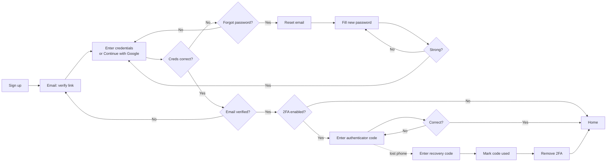
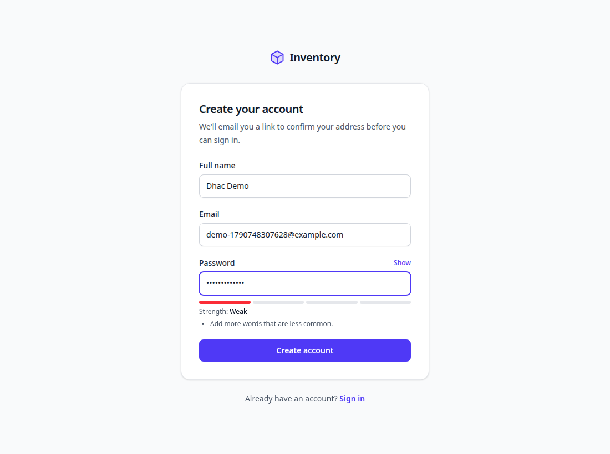
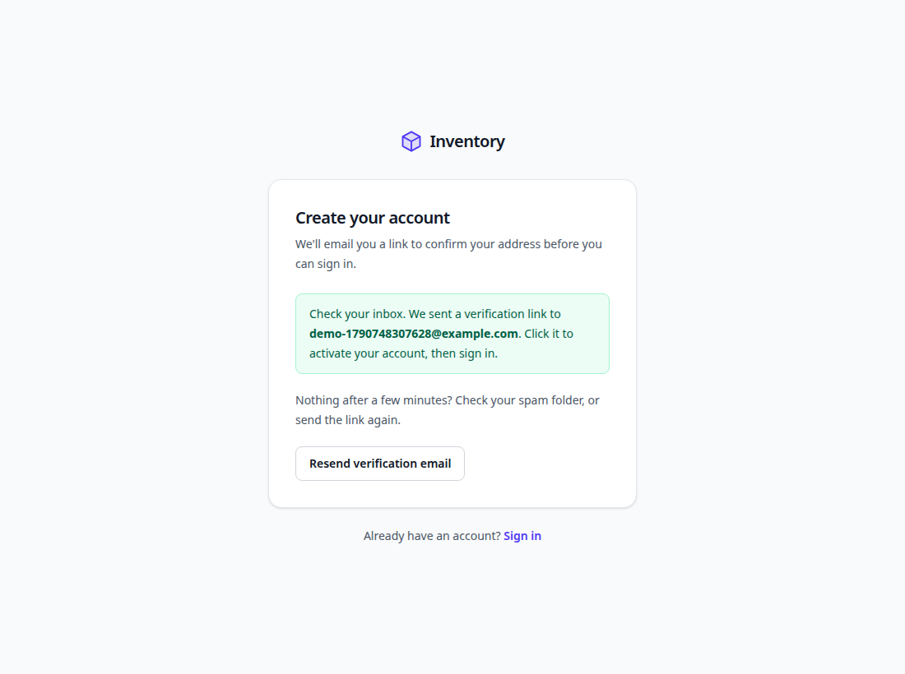
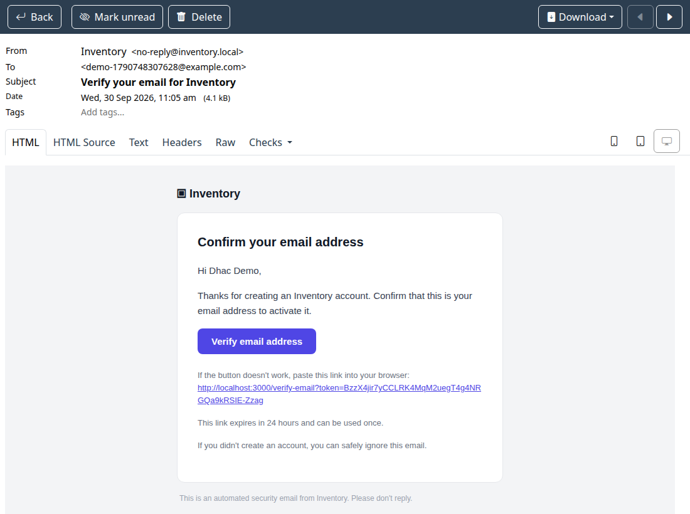
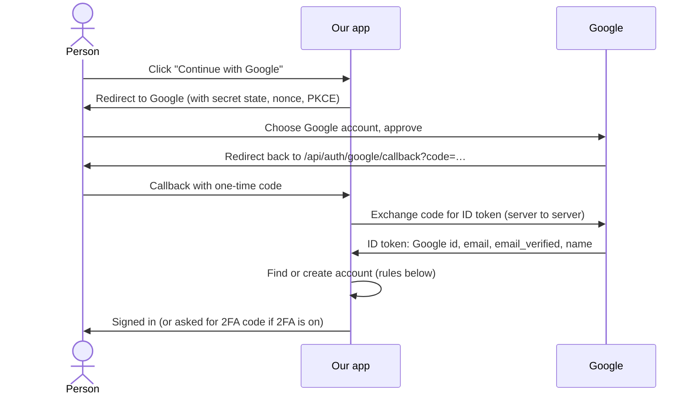
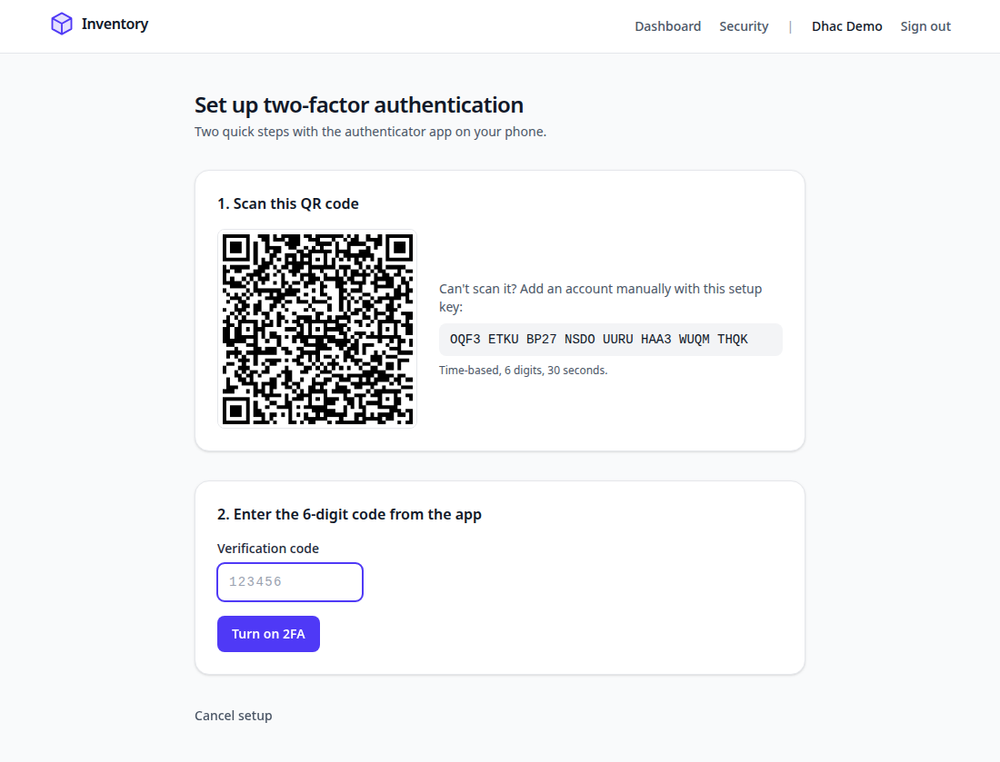
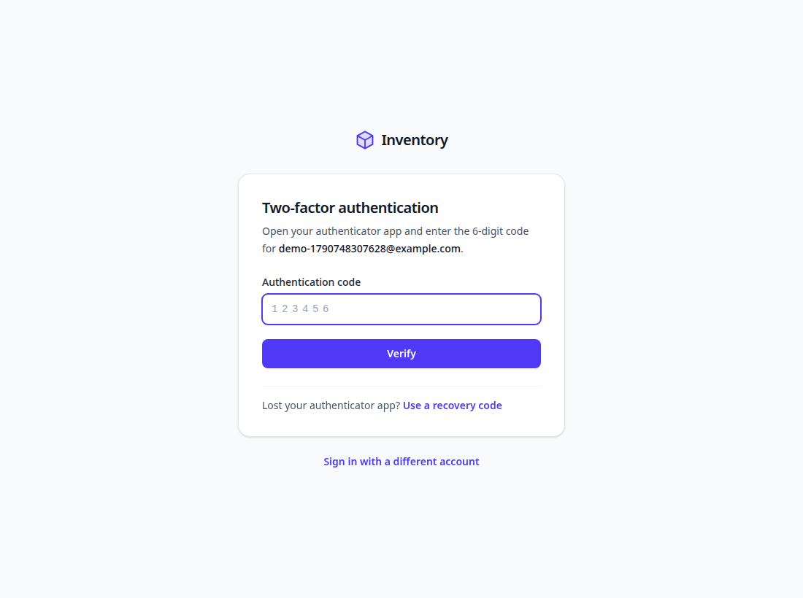
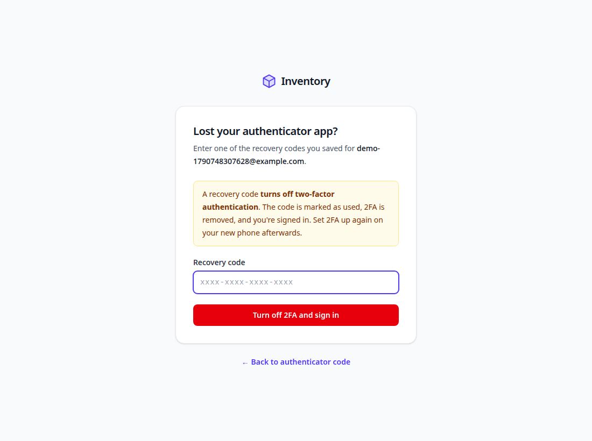

# 4. User flows

## The whole journey on one page

## Pages (addresses)

| Address | Page | Who can open it |
| --- | --- | --- |
| `/signup` | Create account | Anyone signed out |
| `/verify-email?token=…` | Confirm email (opened from the email) | Anyone with the link |
| `/login` | Sign in | Anyone signed out |
| `/login/two-factor` | Enter the 6-digit code | Only right after a correct password, for a 2FA account |
| `/login/recovery` | Use a recovery code | Same as above |
| `/forgot-password` | Ask for a reset email | Anyone |
| `/reset-password?token=…` | Choose a new password (opened from the email) | Anyone with a valid link |
| `/` | Dashboard (home) | Signed in |
| `/settings/security` | Sign-in methods, 2FA, recovery codes | Signed in |
| `/settings/security/two-factor` | Scan QR code, confirm 2FA | Signed in |
| `/api/auth/google` → `/api/auth/google/callback` | Continue with Google | Anyone |
| `/api/health` | "Is the app OK?" check used by the containers | Anyone (no personal data) |

Anyone who isn't signed in and opens a private page is sent to `/login`.

---

## 1. Sign up and verify the email

**What the person does**

1. Opens `/signup` and enters their name, email and a password.
2. Watches the strength meter. Weak passwords show tips ("Add more words that are less common").
3. Clicks **Create account** and sees **"Check your inbox"**.
4. Opens the email **"Verify your email for Inventory"** and clicks **Verify email address**.
5. On the page that opens, clicks the **Verify email address** button, then signs in.

**What the system does**

| Situation | What happens |
| --- | --- |
| Password too weak | The form is shown again with the reasons. Nothing is saved. |
| New email | Account created as **unverified**. A verification email is sent (link valid **24 hours**, works **once**). |
| Email belongs to a verified account | Nothing changes. The *owner* gets "You already have an account". The visitor sees the same "Check your inbox" message, so nobody can find out who has an account. |
| Email belongs to an unverified account | The new sign-up replaces the old attempt (new name and password, old links cancelled). This stops someone from "reserving" another person's email address. |
| Tries to sign in before verifying | Refused: "Please verify your email address first", and a fresh link is sent (at most 3 per 15 minutes). |
| Email didn't arrive | The **Resend verification email** button sends a new link. |

Why a button on the verify page instead of verifying as soon as the link opens? Some email systems
(company spam filters) open every link automatically to scan it. Without the button, they could
verify an address the owner never confirmed.

## 2. Sign in with email and password

1. `/login`: enter email and password.
2. Wrong email or password: **"Incorrect email or password."** plus a **Forgot your password?** link.
   The message is the same whether the email exists or not.
3. Correct, and 2FA is off: the **dashboard** opens.
4. Correct, and 2FA is on: the **two-factor page** opens (see flow 5).

After 10 wrong tries for one email, or 50 from one network, within 15 minutes, sign-in pauses:
"Too many sign-in attempts. Try again in N minutes."

## 3. Continue with Google

Shown on `/login` and `/signup` **only when Google credentials are set** in `.env` ([chapter 9](09-configuration.md)).

| Situation | Result |
| --- | --- |
| This Google account was used before | Signed in (matched by Google's permanent id, even if the Gmail address changed). |
| New Google account, email not in our system | New account created. Already verified, no password. Goes to Security settings with a "turn on 2FA" suggestion. |
| New Google account, email matches a **verified** account | Linked to that account. The owner is emailed "Google sign-in was connected". |
| New Google account, email matches an **unverified** account | Linked, and that account's password is **removed** (whoever set it never proved they own the email). |
| Google says the email is not verified | Refused. |
| Account has 2FA on | The 6-digit code is still required. Google proves the email, not the phone. |

A Google-only account can add a password any time with **Forgot password**.

## 4. Turn on two-factor authentication

1. Dashboard → **Turn on 2FA**, or Security → **Set up authenticator app**.
2. Scan the QR code with an authenticator app, or type the setup key shown next to it.
3. Type the 6-digit code from the app → **Turn on 2FA**.
4. **Save the 10 recovery codes** (Copy or Download .txt). They are shown only once.

If the code is rejected: the phone's clock is probably wrong. Set the time to automatic.

## 5. Signing in with 2FA (code only)

- Only the **6-digit authenticator code** is accepted here. Recovery codes are not.
- Wrong code: "That code didn't work. 4 attempts left." After **5** wrong codes, the person must
  start again from the password.
- The whole step must be finished within **10 minutes** of the correct password.
- Each code works **once** (a code seen over someone's shoulder can't be reused).
- Codes from 30 seconds before or after also work, to allow for slightly wrong clocks.

## 6. Lost phone: use a recovery code

1. On the 2FA page, click **Lost your authenticator app? Use a recovery code**.
2. The page explains: a recovery code **turns off 2FA**.
3. Enter one of the saved codes (letters can be typed in capitals or with spaces) → **Turn off 2FA
   and sign in**.
4. The code is marked used, 2FA is removed (with all remaining codes), all *other* devices are signed
   out, and a security email "Two-factor authentication was turned off" is sent.
5. The dashboard opens with a reminder to set 2FA up again on the new phone.

Recovery codes have **only this purpose**: turning 2FA off when the phone is gone.

## 7. Forgot password

1. `/login` → **Forgot password?** → enter email → **Send reset link**.
2. The page always says "If an account exists for …, we've emailed a link". The same answer for
   every email, so it can't be used to discover accounts.
3. Email **"Reset your Inventory password"** → **Choose a new password** (link valid **30 minutes**,
   works **once**, only the newest link works).
4. Enter the new password twice. A weak password is rejected with tips (the flowchart's
   "pw strong? NO" loop), and the link stays usable.
5. A strong password is saved: **every device is signed out**, "Your password was changed" is
   emailed, and the sign-in page says "Your password has been changed".
6. If the account was unverified, completing a reset also verifies the email (the person just proved
   they can read it).

Limits: 3 reset emails per address and 10 per network, every 15 minutes.

## 8. Security settings (`/settings/security`)

| Section | What it does |
| --- | --- |
| Sign-in methods | Shows whether a password is set and whether Google is connected. |
| Two-factor authentication | On/Off, and when it was enabled. The setup button when off. |
| Recovery codes | How many are unused. **Generate new recovery codes** (needs a current authenticator code) replaces all old ones. |
| Turn off 2FA | Needs a current authenticator code **or** a recovery code. Signs out other devices and sends a security email. |

## 9. Sign out

**Sign out** (top right) deletes the session from the database and the cookie from the browser.

## Emails the system sends

| Email subject | Sent when | Contains |
| --- | --- | --- |
| Verify your email for Inventory | Sign-up, resend, or sign-in attempt while unverified | Verify button (24 h, single use) |
| You already have an Inventory account | Someone signs up with an already-verified email | Sign-in and reset links |
| Reset your Inventory password | Forgot password | Reset button (30 min, single use) |
| Your Inventory password was changed | Password reset completed | Security notice + reset link |
| Two-factor authentication was turned off | Recovery code used, or 2FA turned off in settings | Security notice |
| Google sign-in was connected to your account | Google linked to an existing account | Security notice |
