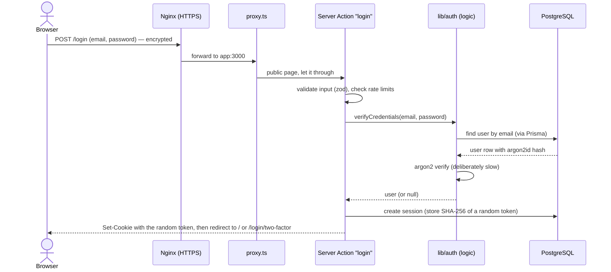
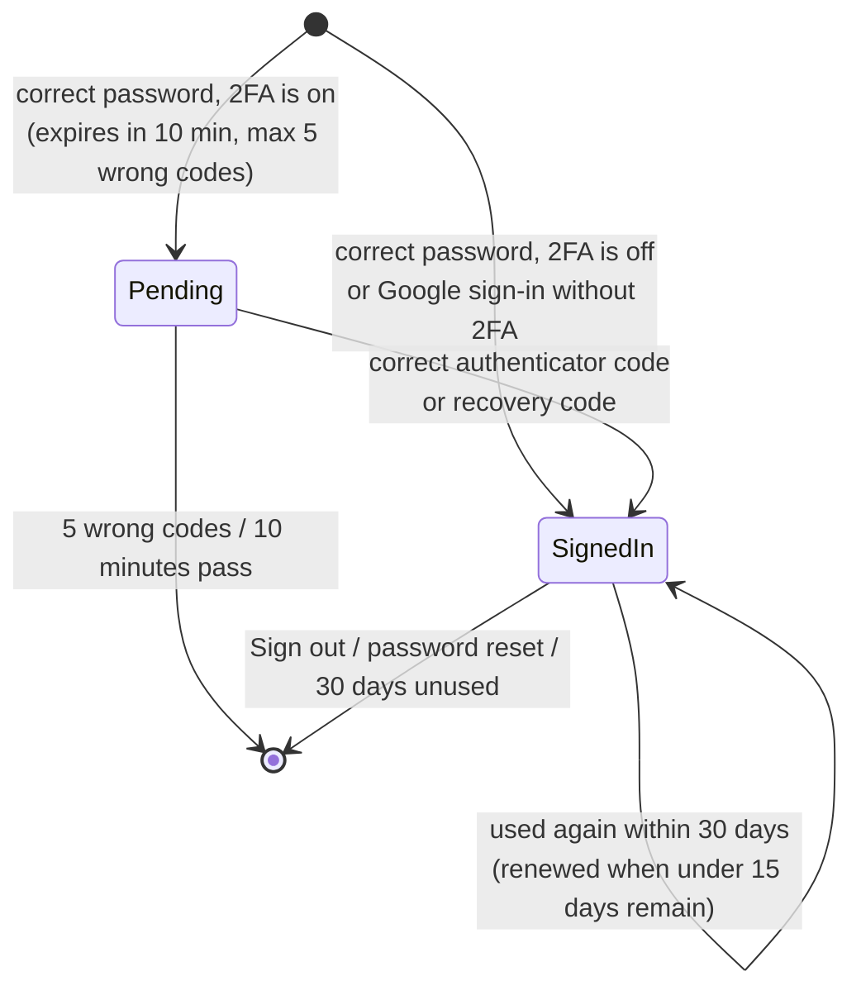

# 5. Backend logic and security

## What happens when someone clicks "Sign in"



Every other action follows the same pattern: **the browser sends a form → a Server Action checks
it → the logic in `src/lib/auth/` does the work → Prisma reads or writes PostgreSQL → the page
updates or moves on**.

## Key Next.js ideas, in plain words

| Idea | Plain meaning | Where |
| --- | --- | --- |
| **Page / Server Component** | A page built on the server; secret data never reaches the browser unless the page shows it. | `src/app/**/page.tsx` |
| **Client Component** | Interactive parts that run in the browser (strength meter, copy buttons). Marked `"use client"`. | `*-form.tsx`, `password-field.tsx` |
| **Server Action** | A function that runs on the server when a form is submitted. Next.js protects it against cross-site forgery automatically. Marked `"use server"`. | `src/app/actions/*.ts` |
| **Route Handler** | A plain web address that returns data or a redirect (not a page). | `src/app/api/**/route.ts` |
| **Proxy** | Runs before every page. Sends visitors without a session cookie to `/login`, and keeps the cookie alive. It only does a quick check: pages do the real check against the database. | `src/proxy.ts` |
| **Data Access Layer (DAL)** | `requireUser()` etc. Every private page and action calls it: it reads the cookie, looks the session up in the database, and redirects if needed. | `src/lib/auth/dal.ts` |

## Code map

```
src/
├── proxy.ts                     First check on every page request
├── app/
│   ├── layout.tsx, globals.css  Shell and styles shared by all pages
│   ├── (auth)/…                 Signed-out pages: login, 2FA, recovery, signup, verify, forgot/reset
│   ├── (app)/…                  Signed-in pages: dashboard, security settings (+ header with Sign out)
│   ├── actions/                 Server Actions (form handlers)
│   │   ├── auth.ts              signup, resendVerification, verifyEmail, login, verifyTwoFactor,
│   │   │                        signInWithRecoveryCode, logout
│   │   ├── two-factor.ts        start/confirm/cancel 2FA setup, new recovery codes, turn 2FA off
│   │   └── password-reset.ts    requestPasswordReset, resetPassword
│   └── api/
│       ├── health/route.ts      {"status":"ok"} if the database answers
│       └── auth/google/…        Google redirect + callback
├── components/                  Reusable UI: fields, buttons, alerts, cards, Google button…
├── lib/
│   ├── auth/                    THE LOGIC (no web-framework code, so it can be tested directly)
│   │   ├── constants.ts         All time limits (see table below)
│   │   ├── session.ts           Create/validate/expire sessions, 2FA attempt counter
│   │   ├── cookies.ts, dal.ts   Session cookie + "who is signed in?" checks
│   │   ├── users.ts             Register, verify password, sign-in methods
│   │   ├── email-verification.ts  Verification links
│   │   ├── password-reset.ts    Reset links and password change
│   │   ├── two-factor.ts        TOTP setup/verify, recovery codes, turning 2FA off
│   │   ├── google.ts            OpenID Connect with Google
│   │   └── google-accounts.ts   Linking Google identities to accounts
│   ├── db.ts                    The one shared Prisma database connection
│   ├── env.ts                   Reads and validates .env (fails loudly if something's missing)
│   ├── crypto.ts                Random tokens, SHA-256, AES-256-GCM encryption
│   ├── password.ts              argon2id hashing
│   ├── password-strength.ts     zxcvbn rules (shared by browser and server)
│   ├── totp.ts                  6-digit codes
│   ├── recovery-codes.ts        Generate/normalise/hash recovery codes
│   ├── rate-limit.ts            Attempt counters stored in PostgreSQL
│   ├── mail.ts, emails.ts       Email template + every email's text
│   ├── validation.ts            Form rules (zod)
│   └── request.ts               Visitor IP and browser info
└── generated/prisma/            Auto-generated database client (never edit)
```

## Sessions: how "staying signed in" works

1. At sign-in the server creates a **random 256-bit token** (a 43-character string) and sends it to
   the browser as a cookie named `session`. The cookie is `HttpOnly` (scripts on the page can't read
   it), `SameSite=Lax` (other websites can't use it), and `Secure` when `APP_URL` is `https://`.
2. The database stores only the token's **SHA-256 hash**. Someone who copied the database still
   couldn't sign in as anyone.
3. On every private page, the DAL hashes the cookie, finds the session, and checks its state:



Other events that end sessions: a password reset signs out **everywhere**; turning 2FA off signs out
every **other** device.

## One-time email links (verification and reset)

- 32 random bytes → sent in the email link. The database keeps only the SHA-256 hash.
- **Single use:** the database row is deleted or marked used in the same step that uses it, so two
  clicks at the same moment can't both succeed.
- **Newest link wins:** asking for a new link cancels the older ones.
- **Expiry:** verification 24 hours, reset 30 minutes.
- The verify page needs a button press, so automatic link scanners can't verify an address.

## Passwords

- Hashed with **argon2id** (19 MiB memory, 2 iterations, 1 thread), OWASP's recommended minimum
  settings. Hashing is deliberately slow and memory-hungry, which makes guessing stolen hashes expensive.
- **Strength rule:** zxcvbn score ≥ 3 out of 4, at least 10 and at most 128 characters. The person's
  own name and email count against them ("priyasharma2026" is rejected for Priya Sharma). The same
  check runs live in the browser (for the meter) and again on the server (which decides).
- **Unknown emails** still go through a dummy argon2 check, so response time doesn't reveal whether
  an account exists. Sign-up also hashes first for the same reason.

## Two-factor authentication

- **Secret:** 160 random bits, shown as the QR code / setup key. Stored **encrypted with AES-256-GCM**
  using `ENCRYPTION_KEY` from `.env`, so a database copy alone doesn't reveal it.
- **Codes:** standard TOTP (SHA-1, 6 digits, 30-second steps), so it works with every authenticator
  app. One step of clock drift either way is accepted.
- **No replays:** the time-step of the last accepted code is saved (`totp_last_used_step`). The same
  or an older code is refused.
- **Setup** is confirmed with a code before 2FA turns on, so a mis-scanned QR code can't lock anyone out.

## Recovery codes

- 10 codes like `se8g-6rh4-63jc-yphk`: 16 characters from 31 easy-to-read symbols (no 0/O, 1/l/I),
  about 79 bits each, so guessing is impossible.
- Stored only as SHA-256 hashes; shown once.
- **Only purpose: turning 2FA off** (lost phone at sign-in, or from settings). Using one marks it used,
  then 2FA and all remaining codes are deleted in the same database transaction.

## Google sign-in (OpenID Connect)

1. `/api/auth/google` creates a random **state** (anti-forgery), **nonce** (ties the answer to this
   request) and **PKCE verifier** (proves the same server finishes the login), stores them encrypted
   in a 10-minute cookie, and redirects to Google.
2. Google sends the person back to `/api/auth/google/callback` with a one-time code.
3. `openid-client` exchanges the code with Google directly and validates the ID token (issuer,
   audience = our client id, expiry, nonce).
4. `signInWithGoogle` applies the linking rules in [chapter 4](04-user-flows.md#3-continue-with-google).
5. A normal session is created. If 2FA is on, the session starts as *Pending*.

## Rate limits (brute-force protection)

Counters live in the `rate_limits` table and are shared by every app copy.

| Action | Limit |
| --- | --- |
| Sign in, per email | 10 per 15 min (reset after a successful sign-in) |
| Sign in, per network (IP address) | 50 per 15 min |
| Sign up, per email / per network | 5 / 10 per hour |
| Verification emails, per email / per network | 3 / 10 per 15 min |
| Reset emails, per email / per network | 3 / 10 per 15 min |
| New recovery codes or turning 2FA off, per user | 5 per 15 min |
| Wrong 2FA codes, per sign-in attempt | 5, then back to the password step |

## Emails

`sendEmailInBackground()` hands the email over **after** the page has responded, so users don't wait
for the mail server, and timing can't reveal whether an account exists. Failures are logged
(`[email] failed to send …` in the app logs) but never shown to the visitor. Every email uses one
template (`src/lib/mail.ts`) with an HTML and a plain-text version, and the text lives in
`src/lib/emails.ts`.

## Container start-up logic

`docker/start.mjs` is the app container's first program. It lists the migrations bundled in the
image, waits until the database says all of them are applied (checking every 2 seconds, for up to 5
minutes), and only then starts the web server. This guarantees the app never runs against an older
table layout, even though podman-compose may start the app and the migration job at the same time.

## All the numbers, and where to change them

| Setting | Value | File |
| --- | --- | --- |
| Session lifetime / renewal | 30 days / when < 15 days left | `src/lib/auth/constants.ts` |
| Time to finish 2FA after the password | 10 minutes | `src/lib/auth/constants.ts` |
| Wrong 2FA codes allowed | 5 | `src/lib/auth/constants.ts` |
| Verification / reset link lifetime | 24 hours / 30 minutes | `src/lib/auth/constants.ts` |
| Password length / strength | 10–128 characters / zxcvbn ≥ 3 | `src/lib/password-strength.ts` |
| Number of recovery codes | 10 | `src/lib/recovery-codes.ts` |
| argon2 cost | 19 MiB, 2 iterations | `src/lib/password.ts` |
| Rate limits | table above | `src/app/actions/*.ts` |
| Security headers | X-Frame-Options, nosniff, Referrer-Policy, Permissions-Policy | `next.config.ts` (+ HSTS in `deploy/nginx/https.conf.template`) |

## Security summary

| Threat | Protection |
| --- | --- |
| Password guessing | Rate limits, 2FA, strong-password rule |
| Stolen database | argon2id password hashes, hashed session/link/recovery tokens, encrypted 2FA secrets |
| Finding out who has an account | Same answers and similar timing for existing and unknown emails |
| Someone "pre-registering" your email | Verification required; unverified sign-ups can be replaced; Google linking removes unproven passwords |
| Reused or intercepted 2FA code | Replay protection, 30-second codes, 5-attempt limit |
| Stolen session cookie via page scripts | `HttpOnly`, `SameSite=Lax`, `Secure` cookies |
| Cross-site form forgery | Next.js Server Action origin check; `SameSite` cookies; OAuth state + PKCE |
| Clickjacking (site hidden in a frame) | `X-Frame-Options: DENY` |
| Snooping on the network | HTTPS via Nginx + a Let's Encrypt certificate (Certbot), TLS 1.2/1.3 only, HSTS header |
| Faking an IP address to dodge rate limits | Nginx overwrites `X-Forwarded-For` with the real client address |
| Email link grabbed later | Single use, short expiry, newest-only |
| Account changed without the owner knowing | Security notice emails |
| Secret code leaking into the browser | `server-only` guards; pages return only safe fields |
