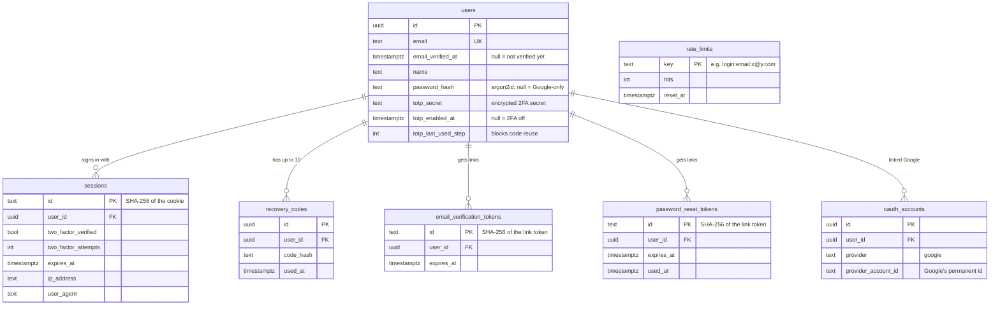
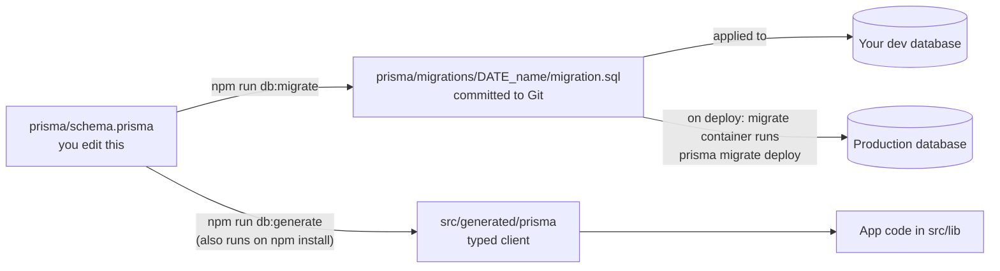

# 6. Database and Prisma

## PostgreSQL: the filing cabinet

PostgreSQL 18 runs in the `db` container. It keeps its files in the host folder set by
`POSTGRES_DATA_DIR` (currently `./data/postgres`), so deleting or rebuilding the container never
loses data.

| Who connects | Address used | Set in |
| --- | --- | --- |
| The app and migrate containers | `db:5432` (the private container network) | built from `POSTGRES_*` in `compose.yaml` |
| Your laptop (`npm run dev`, Prisma CLI, tests) | `localhost:5432` | `DATABASE_URL`, `TEST_DATABASE_URL` in `.env` |
| Other computers | **not possible**: port 5432 is bound to `127.0.0.1` only | `compose.yaml` |

There are two databases inside the same PostgreSQL:

- `inventory`: the real data.
- `inventory_test`: created and emptied automatically by `npm test`. Its name must end in `_test`,
  so the tests refuse to run against the real database by mistake.

## The tables



| Table | One row is… | Removed when |
| --- | --- | --- |
| `users` | one account | (never automatically) |
| `sessions` | one signed-in browser | sign out, expiry, password reset, 2FA turned off (other devices) |
| `recovery_codes` | one recovery code (hashed) | 2FA turned off, or new codes generated |
| `email_verification_tokens` | one verification link | used, replaced by a newer link |
| `password_reset_tokens` | one reset link | replaced; marked `used_at` when used |
| `oauth_accounts` | one Google account linked to a user | user deleted |
| `rate_limits` | one attempt counter | cleaned up automatically after it expires |
| `_prisma_migrations` | one applied migration (Prisma's own history) | never |

Deleting a user deletes all their rows in the other tables automatically ("cascade").

## Prisma: the translator

Prisma has three jobs:

1. **Describe** the tables in one readable file: `prisma/schema.prisma`.
2. **Migrate:** when the schema file changes, write a numbered SQL "change file" (a migration) and
   apply it to the database.
3. **Generate a client:** typed functions like `prisma.user.findUnique({ where: { email } })`, so the
   code can't ask for a column that doesn't exist.



### The Prisma files

| File | Purpose |
| --- | --- |
| `prisma/schema.prisma` | The tables, columns and relationships. **The source of truth.** |
| `prisma/migrations/20260929101514_init/` | Migration 1: users, sessions, recovery codes, reset tokens |
| `prisma/migrations/20260930053030_email_verification_google_rate_limits/` | Migration 2: email verification, Google accounts, rate limits (+ marks older accounts verified) |
| `prisma/migrations/migration_lock.toml` | Records that the database is PostgreSQL |
| `prisma7.config.ts` | Tells the Prisma CLI where the schema and migrations are and reads `DATABASE_URL` from `.env` |
| `src/generated/prisma/` | The generated client (not in Git; rebuilt by `npm run db:generate`) |
| `src/lib/db.ts` | Creates the single shared connection, using the `pg` driver adapter |

### Prisma commands

| Command | What it does | Where to use |
| --- | --- | --- |
| `npm run db:migrate -- --name add_phone` | Compares the schema to the dev database, writes a new migration, applies it, regenerates the client | Development only |
| `npm run db:generate` | Rebuilds `src/generated/prisma` (needed after `git pull` if the schema changed) | Development |
| `npm run db:deploy` | Applies migrations that haven't run yet. Never creates new ones. | Production (the `migrate` container does this for you) |
| `npm run db:studio` | Opens **Prisma Studio**, a spreadsheet-like view of the data, at http://localhost:5555 | Development |
| `npx prisma migrate status` | Lists which migrations are applied | Anywhere |
| `npx prisma validate` | Checks `schema.prisma` for mistakes | Anywhere |

## How to change the database (worked example)

Say you want to store a phone number for each user.

**1. Edit `prisma/schema.prisma`** and add one line inside `model User { … }`:

```prisma
  phone           String?   @map("phone")
```

(`?` means "optional"; `@map` sets the column name in the database.)

**2. Create and apply the migration** on your development machine:

```bash
npm run services:up                       # database must be running
npm run db:migrate -- --name add_user_phone
```

Prisma writes `prisma/migrations/<timestamp>_add_user_phone/migration.sql` containing
`ALTER TABLE "users" ADD COLUMN "phone" TEXT;`, applies it, and regenerates the client. **Open the
file and read it.** If it contains `DROP` (deleting data), stop and think.

**3. Use it in code**, e.g. `prisma.user.update({ where: { id }, data: { phone } })`. TypeScript
now knows about `phone`.

**4. Test and commit:**

```bash
npm run typecheck && npm test
git add prisma/ src/ && git commit -m "Add phone number to users"
git push
```

**5. Deploy.** On the server, `git pull && podman compose up -d --build`. The `migrate` container
applies the new migration, and the app waits for it before starting ([chapter 10](10-operations.md)).

### Rules that keep data safe

1. **Never edit or delete a migration that has already been applied** anywhere. Make a new one instead.
2. **Back up before deploying a migration** (`./scripts/backup-db.sh`). Migrations only go forward;
   the way back is restoring the backup.
3. **Renaming** a field in the schema looks like "drop old column + add new column" to Prisma, which
   loses data. Use `npx prisma migrate dev --create-only`, edit the SQL to
   `ALTER TABLE … RENAME COLUMN …`, then run `npm run db:migrate` to apply it. (Migration 2 was
   hand-edited the same way, to add a line that marks existing accounts as verified.)
4. **Adding a required column** to a table that has rows needs a default value (`@default(...)`).
5. Never run `prisma migrate reset` or `db push` against production: they are for throwaway
   development databases.
6. **Never change `ENCRYPTION_KEY`**: the 2FA secrets in `users.totp_secret` would become unreadable.

## Looking at the data directly

**Prisma Studio** (easiest): `npm run db:studio` → http://localhost:5555.

**psql** (the PostgreSQL command line), inside the container:

```bash
podman exec -it inventory-management-system_db_1 psql -U inventory -d inventory
```

Useful commands inside psql: `\dt` (list tables), `\d users` (describe a table), `\q` (quit).

### Admin recipes (for support situations)

Run these inside psql. **Make a backup first.** Replace the email address.

```sql
-- List accounts
SELECT email, name, email_verified_at IS NOT NULL AS verified,
       totp_enabled_at IS NOT NULL AS has_2fa, password_hash IS NOT NULL AS has_password, created_at
FROM users ORDER BY created_at;

-- Mark an email as verified by hand
UPDATE users SET email_verified_at = now() WHERE email = 'person@example.com';

-- Someone lost their phone AND their recovery codes (confirm who they are first!):
BEGIN;
UPDATE users SET totp_secret = NULL, totp_enabled_at = NULL, totp_last_used_step = NULL
  WHERE email = 'person@example.com';
DELETE FROM recovery_codes WHERE user_id = (SELECT id FROM users WHERE email = 'person@example.com');
DELETE FROM sessions       WHERE user_id = (SELECT id FROM users WHERE email = 'person@example.com');
COMMIT;

-- Unblock someone who hit a rate limit
DELETE FROM rate_limits WHERE key LIKE '%person@example.com%';

-- Sign a user out everywhere
DELETE FROM sessions WHERE user_id = (SELECT id FROM users WHERE email = 'person@example.com');
```

Passwords can't be read or set by hand: they're hashed. Use **Forgot password** instead.
