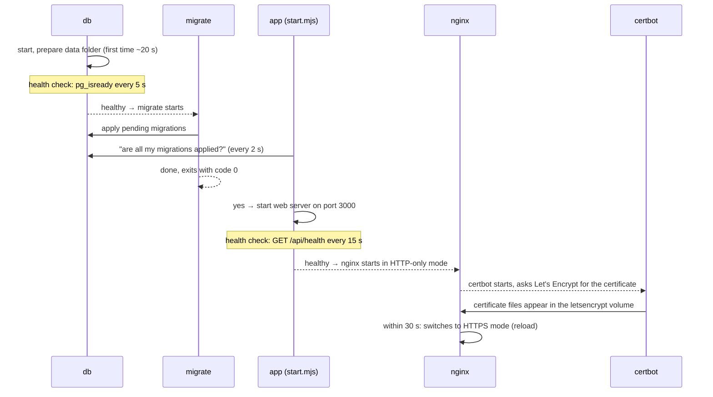
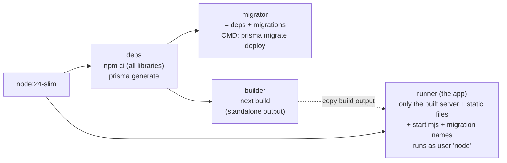

# 7. Containers and storage

## The ideas, with an analogy

| Word | Analogy | In this project |
| --- | --- | --- |
| **Image** | A sealed, read-only lunchbox recipe | `localhost/inventory-management-system:latest` |
| **Container** | A lunchbox made from the recipe, being used right now | `inventory-management-system_app_1` |
| **Bind mount** | A shelf in *your* kitchen that the box can use | `./data/postgres` → the database files |
| **Named volume** | A storage locker Podman manages for you | `letsencrypt` (HTTPS certificates) |
| **`compose.yaml`** | The menu listing every box and how they connect | project root |
| **Profile** | Optional dishes you only order when needed | `dev` (Mailpit), `https` (Nginx + Certbot) |

Containers are **disposable**: anything written inside a container (not in a mount or volume) is lost
when it's deleted. That's intended. All data that matters lives in the database folder.

## How many containers?

Six services are defined in `compose.yaml`. How many run depends on the command:

| Mode | Command | Containers | Running afterwards |
| --- | --- | --- | --- |
| Development | `npm run services:up` | `db`, `mailpit` | 2 |
| Production (HTTP) | `podman compose up -d --build` | `db`, `migrate`, `app` | 2 (`migrate` finishes and stops) |
| Production + HTTPS | `podman compose --profile https up -d --build` | `db`, `migrate`, `app`, `nginx`, `certbot` | 4 |
| Full local test | `podman compose --profile dev up -d --build` | `db`, `migrate`, `app`, `mailpit` | 3 |

The browser tests also use a headless Chromium on the laptop, but that isn't a container.

## The six services

| Service | Image | Job | Host ports | Storage | Restarts |
| --- | --- | --- | --- | --- | --- |
| `db` | `postgres:18-alpine` | The database | `127.0.0.1:5432` | `POSTGRES_DATA_DIR` → `/var/lib/postgresql` | always |
| `migrate` | `…-migrator` (built) | Runs `prisma migrate deploy` once, then exits | none | none | no (one-shot job) |
| `app` | `inventory-management-system` (built) | The website + backend | `APP_BIND:APP_PORT` (default `127.0.0.1:3000`) | none (stateless) | always |
| `nginx` (profile `https`) | `nginx:stable-alpine` | HTTPS front door: redirects HTTP → HTTPS, adds HSTS, forwards to `app:3000` | `80`, `443` | reads `letsencrypt`, `certbot-webroot` | always |
| `certbot` (profile `https`) | `certbot/certbot` | Gets the Let's Encrypt certificate, then checks twice a day and renews it when needed | none | writes `letsencrypt`, `certbot-webroot` | always |
| `mailpit` (profile `dev`) | `axllent/mailpit` | Catches emails in development | `127.0.0.1:1025` (SMTP), `127.0.0.1:8025` (inbox) | none | always |

Container names follow the pattern `inventory-management-system_<service>_1`, e.g.
`inventory-management-system_db_1`.

## Start-up order



Why the app checks for migrations itself: podman-compose 1.6 can start the app before the
`migrate` job has finished (a known bug). `docker/start.mjs` makes the order correct anyway.

## How our two images are built (`Dockerfile`)



- **Multi-stage:** heavy build tools stay in the `deps`/`builder` stages. The final `runner` image
  contains only what's needed to run (288 MB instead of more than 1 GB).
- **Standalone output:** Next.js copies only the files the server actually uses into
  `.next/standalone`.
- **Non-root:** the app runs as the unprivileged `node` user inside the container.
- **Layer cache:** if only code changed, `npm ci` isn't repeated, so rebuilds are much faster.
- `.dockerignore` keeps secrets (`.env`), the database folder, backups and `node_modules` out of the
  build.

## Where data lives, and what survives what

| Data | Stored in | Survives restart / rebuild / `down`? | Survives `down -v`? |
| --- | --- | --- | --- |
| Accounts, sessions, tokens, rate limits | `POSTGRES_DATA_DIR` (bind mount) | ✅ | ✅ (bind mounts are never deleted by Podman) |
| HTTPS certificates + Let's Encrypt account | `letsencrypt` named volume | ✅ | ❌ deleted (Certbot requests a new one; avoid doing this often, Let's Encrypt limits requests per week) |
| Let's Encrypt challenge files | `certbot-webroot` named volume | ✅ | ❌ (harmless, recreated) |
| Emails in Mailpit | inside the container | ❌ lost on recreate (fine, it's a test inbox) | ❌ |
| The app | nothing (stateless) | — | — |

The folder on the host:

```
data/postgres/            ← POSTGRES_DATA_DIR
└── 18/
    └── docker/           ← PostgreSQL 18's files (owned by the container's postgres user)
```

The files inside belong to the container's `postgres` user, which on the host shows up as a high
number (on this laptop 524357). Rootless Podman maps container users to such numbers for safety. That's
why your normal user can't read the files, and why backups use `pg_dump` instead of copying the folder.
To delete the folder completely: `podman unshare rm -rf data/postgres`.

The `:Z` at the end of the mount in `compose.yaml` tells **SELinux** (Fedora's file guard) that this
folder is private to the database container.

### Leftovers from before

- `inventory-management-system_pgdata`: the named volume the database used on day one, before it
  moved to `./data/postgres`. The data was copied over.
- `inventory-management-system_caddy-data` and `…_caddy-config`: from the local Caddy test, before
  HTTPS switched to Nginx + Certbot. They hold only a local test certificate.

Delete them when you're satisfied:

```bash
podman volume rm inventory-management-system_pgdata \
  inventory-management-system_caddy-data inventory-management-system_caddy-config
podman rmi docker.io/library/caddy:2-alpine      # the unused Caddy image
```

## Inside each container

| Container | Important paths |
| --- | --- |
| `app` | `/app/start.mjs` (entry point), `/app/server.js` (Next.js server), `/app/.next/static`, `/app/public`, `/app/prisma/migrations` (names only) |
| `migrate` | `/app/node_modules`, `/app/prisma/…`, `/app/prisma7.config.ts` |
| `db` | `/var/lib/postgresql/18/docker` (the data, = your `POSTGRES_DATA_DIR`) |
| `nginx` | `/etc/nginx/ims/` (= `deploy/nginx/`, read-only: templates + `entrypoint.sh`), `/etc/nginx/conf.d/default.conf` (generated at start), `/etc/letsencrypt` (certificates, read-only), `/var/www/certbot` (challenge files, read-only) |
| `certbot` | `/etc/ims-certbot/` (= `deploy/certbot/`, read-only), `/etc/letsencrypt/live/<DOMAIN>/` (`fullchain.pem`, `privkey.pem`), `/var/www/certbot/.well-known/acme-challenge/` |

On the host, Podman keeps images, layers and named volumes in `~/.local/share/containers/storage/`.

## Health checks

| Container | Check | Healthy means |
| --- | --- | --- |
| `db` | `pg_isready` every 5 s (60 s grace on first start) | database accepts connections |
| `app` | `GET http://127.0.0.1:3000/api/health` every 15 s | web server is up **and** the database answers |

`podman compose ps` shows `(healthy)` / `(unhealthy)` next to each container. `nginx` and `certbot`
have no health check. Their logs say what they're doing (`podman compose --profile https logs nginx certbot`).

## Rootless Podman

Everything runs as your normal user, not as `root`. Even if something inside a container were
compromised, it would have only your user's rights, not the whole machine's. Side effects:

- Ports below 1024 (80, 443) need `net.ipv4.ip_unprivileged_port_start=80` ([chapter 8](08-networking-domain-https.md)).
- Containers stop when you log out, unless "linger" is enabled ([chapter 10](10-operations.md#start-automatically-after-a-reboot)).

## Container cheat sheet

Run these from the project folder:

```bash
podman compose ps                              # what's running and healthy
podman compose logs -f app                     # follow the app's log (Ctrl+C to stop)
podman compose logs migrate                    # did migrations succeed?
podman compose restart app                     # restart one service
podman compose up -d --build                   # rebuild images and recreate what changed
podman compose --profile dev --profile https down   # stop and remove all containers (data is kept)
podman exec -it inventory-management-system_db_1 psql -U inventory -d inventory   # database shell
podman images                                  # list images
podman image prune                             # delete unused old images (frees disk space)
podman system df                               # disk used by Podman
```
