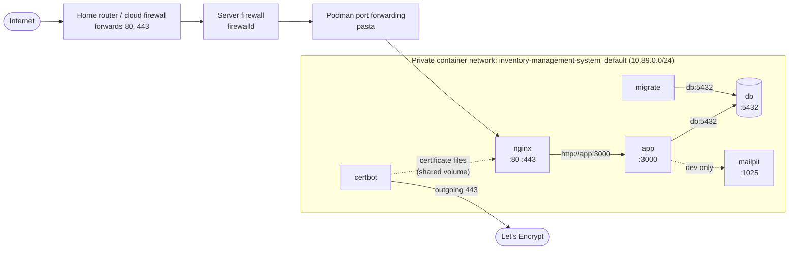
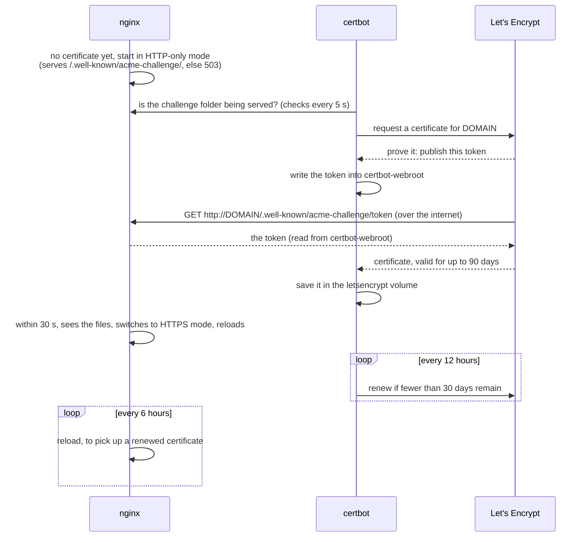

# 8. Networking, domain and HTTPS

## Ports: every numbered door

| Port | Protocol | Who listens | Reachable from | Setting |
| --- | --- | --- | --- | --- |
| **443** | HTTPS | Nginx | the internet (when the `https` profile is on) | `HTTPS_PORT` |
| **80** | HTTP | Nginx: answers Let's Encrypt checks, redirects everyone else to 443 | the internet | `HTTP_PORT` |
| **3000** | HTTP | The app | `127.0.0.1` only by default; the network if `APP_BIND=0.0.0.0` | `APP_BIND`, `APP_PORT` |
| **5432** | PostgreSQL | Database | `127.0.0.1` only (your laptop's tools) | `POSTGRES_PORT` |
| **8025** | HTTP | Mailpit inbox (dev) | `127.0.0.1` only | — |
| **1025** | SMTP | Mailpit mail server (dev) | `127.0.0.1` only | — |
| **5555** | HTTP | Prisma Studio (only while `npm run db:studio` runs) | `127.0.0.1` only | — |

The `certbot` container opens **no** ports. It only makes outgoing connections to Let's Encrypt.

### Which ports are open after which command

| Command | Ports on the computer |
| --- | --- |
| `npm run services:up` (development) | `127.0.0.1:5432` (db), `127.0.0.1:1025` + `127.0.0.1:8025` (Mailpit). Then `npm run dev` adds `3000` (the dev server itself, not a container). |
| `podman compose up -d --build` (production) | `127.0.0.1:3000` (app container), `127.0.0.1:5432` (db) |
| `podman compose --profile dev up -d --build` | the above + `127.0.0.1:1025`, `127.0.0.1:8025` (Mailpit) |
| `podman compose --profile https up -d --build` | the above + `80` and `443` on **all** interfaces (Nginx) |

Port 3000 is always "the app", whether it's served by `npm run dev` on the laptop or by the `app`
container. Only one of them can hold the port at a time. The `migrate` container has no ports.

**Outgoing** connections the server must be allowed to make: your SMTP provider (port 587 or 465),
`accounts.google.com` / `oauth2.googleapis.com` (443, only if Google sign-in is on), Let's Encrypt
(443, from the certbot container), and the container/npm registries (443, only while building).

## `127.0.0.1` vs `0.0.0.0`

- **`127.0.0.1` (localhost)** means "only this computer". The database and dev tools always use it,
  so nobody else on the Wi-Fi can reach them.
- **`0.0.0.0`** means "every network this computer is on". Set `APP_BIND=0.0.0.0` only if other
  computers must reach the app directly on port 3000 (see scenario B).

## How traffic flows



- `podman compose` creates a private network called `inventory-management-system_default`. Inside
  it, containers find each other **by service name**: the app connects to `db`, Nginx forwards to
  `app`, Certbot checks `nginx` (Podman's `aardvark-dns` answers these names).
- Traffic between containers stays inside the machine, so it doesn't need encryption.
- Only ports listed under `ports:` in `compose.yaml` are reachable from outside the network.
  Everything else is closed by default.

## Three ways to run it

### A. Just this computer

The default. Open http://localhost:3000. Nothing is reachable from other devices.

### B. Office / home network, no domain

```bash
# .env
APP_BIND=0.0.0.0
APP_URL=http://192.168.200.24:3000      # this laptop's address today; find yours: hostname -I
```

Then `podman compose up -d --build` and open that address from other devices.

- Fedora Workstation/KDE's firewall already allows ports 1025–65535, so port 3000 works right away.
  On Fedora *Server*: `sudo firewall-cmd --permanent --add-port=3000/tcp && sudo firewall-cmd --reload`.
- Traffic is **not encrypted** and cookies aren't marked `Secure`. Acceptable on a trusted network
  for testing. For real use, choose C.
- **Google sign-in doesn't work here**: Google only allows plain `http://` for `localhost`.
- Give the machine a fixed address in your router (DHCP reservation), or `APP_URL` will go stale.

### C. On the internet with your own domain (recommended)

What you need:

1. **A server** with a public IP address: a VPS (Hetzner, DigitalOcean, AWS Lightsail…) or a machine
   at home with a public IP.
2. **A domain** from any registrar (Namecheap, Cloudflare, GoDaddy, a local .pk registrar…).
3. **Ports 80 and 443** reachable from the internet. **Port 80 is required**: Let's Encrypt checks
   it (see below).

#### Step 1: Point the domain at the server (DNS)

In your registrar's DNS settings, add a record:

| Type | Name | Value | TTL |
| --- | --- | --- | --- |
| `A` | `inventory` (for `inventory.example.com`) or `@` (for `example.com`) | the server's public IPv4 (`curl -4 ifconfig.me` on the server) | 300 |

Check it (can take a few minutes to an hour):

```bash
getent hosts inventory.example.com      # should print the server's IP
```

#### Step 2: Configure `.env`

```bash
DOMAIN=inventory.example.com
APP_URL=https://inventory.example.com
APP_BIND=127.0.0.1                  # the app is only reached through Nginx
LETSENCRYPT_EMAIL=you@example.com   # optional
LETSENCRYPT_STAGING=false           # true = practise with Let's Encrypt's test servers first
```

#### Step 3: Let rootless Podman use ports 80/443, and open the firewall

Linux normally reserves ports below 1024 for `root`. This lets normal users use them from 80 up:

```bash
echo 'net.ipv4.ip_unprivileged_port_start=80' | sudo tee /etc/sysctl.d/50-unprivileged-ports.conf
sudo sysctl --system
sudo firewall-cmd --permanent --add-service=http --add-service=https   # 80 and 443
sudo firewall-cmd --reload
```

On a cloud VPS, also open 80 and 443 in the provider's firewall / security group.

#### Step 4: Start with HTTPS

```bash
podman compose --profile https up -d --build
podman compose --profile https logs -f certbot   # watch for "certificate in place for …"
podman compose --profile https logs nginx        # "reloaded (https mode)"
```

Open `https://inventory.example.com`. You should see the padlock. Until the certificate exists
(usually under a minute), the site answers "HTTPS is being set up…".

## How Let's Encrypt works here

Two containers share two volumes:

| Volume | Written by | Read by | Contents |
| --- | --- | --- | --- |
| `letsencrypt` | certbot | nginx (read-only) | Let's Encrypt account, certificate (`fullchain.pem`) and private key (`privkey.pem`) |
| `certbot-webroot` | certbot | nginx (read-only) | temporary "challenge" files Let's Encrypt downloads to confirm you control the domain |



- **Nothing to do by hand.** The first certificate and every renewal happen automatically.
- If issuing fails (DNS not pointing here yet, port 80 blocked), Certbot logs the reason and **retries
  every 15 minutes**. The retry gap keeps it under Let's Encrypt's limit of 5 failed checks per hour.
- **Test first if unsure:** `LETSENCRYPT_STAGING=true` uses Let's Encrypt's test servers (no weekly
  limits, but browsers won't trust the certificate). Before switching to `false`, delete the test
  certificate: `podman volume rm inventory-management-system_letsencrypt`.
- **Don't delete the `letsencrypt` volume repeatedly**: Let's Encrypt limits how many certificates
  one domain can get per week.
- **`DOMAIN=localhost`** (local testing): Let's Encrypt doesn't issue certificates for `localhost`, so
  Certbot creates a self-signed one. Browsers warn about it; that's expected.

### The files behind it (`deploy/`)

| File | Job |
| --- | --- |
| `deploy/nginx/entrypoint.sh` | Nginx's start script: puts `DOMAIN` into the right template, starts Nginx, checks every 30 s whether the certificate appeared, and reloads every 6 hours |
| `deploy/nginx/http-only.conf.template` | Used until the certificate exists: serves challenge files, answers 503 "HTTPS is being set up" |
| `deploy/nginx/https.conf.template` | The real config (below) |
| `deploy/certbot/certbot.sh` | Certbot's script: wait for Nginx, get the certificate (retry every 15 min), renew check every 12 h |
| `deploy/certbot/self_signed.py` | Makes the self-signed test certificate for `DOMAIN=localhost` |

The HTTPS part of the Nginx config, in plain words:

| Setting | Meaning |
| --- | --- |
| `listen 80` + `return 301 https://…` | Everyone on plain HTTP is sent to HTTPS (except Let's Encrypt's challenge path) |
| `listen 443 ssl` + `http2 on` | Encrypted connections, HTTP/2 for speed |
| `ssl_certificate …/fullchain.pem`, `ssl_certificate_key …/privkey.pem` | The files Certbot maintains |
| `ssl_protocols TLSv1.2 TLSv1.3` | Only modern, secure encryption versions |
| `Strict-Transport-Security …` (HSTS) | Browsers will use only HTTPS for this site for a year |
| `server_tokens off` | Don't reveal the Nginx version |
| `gzip on` | Compress pages |
| `proxy_pass http://app:3000` | Forward requests to the app container |
| `proxy_set_header Host $http_host` (+ `X-Forwarded-Host`, `X-Forwarded-Proto`) | Tell the app the original address and that it was HTTPS. Next.js needs the original host to accept form submissions. |
| `proxy_set_header X-Forwarded-For $remote_addr` | Pass the visitor's real IP (used for rate limits); overwritten, so it can't be faked |

After editing a template: `podman compose --profile https restart nginx`.

## Why Nginx + Certbot?

Both Nginx and Caddy are **reverse proxies**: web servers that sit in front of the app, handle HTTPS,
and forward requests to it. The app itself only speaks plain HTTP on port 3000 and can't obtain
certificates. Phase one first used Caddy, then switched to **Nginx** at the project owner's request.

| | Nginx + Certbot (current) | Caddy (earlier) |
| --- | --- | --- |
| HTTPS certificates | Certbot gets and renews them; our scripts make Nginx pick them up | Built into Caddy |
| Containers | 2 (`nginx`, `certbot`) | 1 |
| Config for this app | ~50 lines in two templates + two small scripts | ~10 lines |
| Popularity | The most widely used web server; huge number of guides; common in companies | Well known, growing |
| Speed and features | Very fast; mature caching, load balancing and rate-limiting | More than enough for this app |
| Challenge types | HTTP on port 80 (webroot), so **port 80 must be open** | HTTP on 80 or TLS on 443 |

The app doesn't care which proxy is in front of it, as long as the proxy forwards to `app:3000` and
passes the original `Host` header.

## Hosting from home: extra notes

- In the router, **forward** TCP 80 and 443 to the server's local IP (e.g. `192.168.200.24`).
- Check your router's WAN IP equals `curl -4 ifconfig.me`. If not, your ISP uses **CGNAT** (shared
  IPs) and incoming connections can't reach you. Ask the ISP for a public IP, use a VPS, or use a
  tunnel service such as Cloudflare Tunnel (not set up in phase one).
- Home IPs can change. Use a dynamic-DNS service or your registrar's API to keep the `A` record
  updated.
- Some ISPs block incoming port 80. Certbot's HTTP check then fails. Options: ask the ISP to unblock
  it, use a VPS, or switch Certbot to a **DNS challenge** with your DNS provider's plugin (not set up
  in phase one).

## Why `APP_URL` must be right

`APP_URL` is used for:

- the links inside emails (verify, reset). A wrong value means broken links.
- deciding whether cookies are `Secure` (`https://` → yes).
- the Google redirect address `<APP_URL>/api/auth/google/callback`, which must match what's registered
  in the Google Cloud console **exactly**.

Next.js also checks that form submissions come from the same host as the page (protection against
cross-site forgery). Nginx passes the original host through (`Host $http_host`), so this works
without extra settings.

## Quick network tests

```bash
curl -I http://localhost:3000/login          # app answers locally (HTTP 200)
curl http://localhost:3000/api/health        # {"status":"ok"}
curl -I http://inventory.example.com         # Nginx: 301 redirect to https://
curl -I https://inventory.example.com        # through Nginx with HTTPS (HTTP/2 200)
ss -tln | grep -E ':(80|443|3000|5432) '     # which ports are listening
sudo firewall-cmd --list-all                 # what the firewall allows
```
