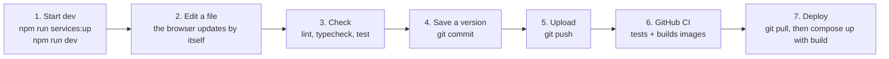

# 11. Making changes

## The safe way to change anything



```bash
cd ~/Projects/inventory-management-system
npm run services:up && npm run dev          # 1. open http://localhost:3000
# 2. edit files in the editor (Cursor / VS Code)
npm run lint && npm run typecheck && npm test   # 3. all must pass
git add -A && git commit -m "Explain what changed"   # 4.
git push                                        # 5. then watch GitHub → Actions
# 7. on the server:
./scripts/backup-db.sh && git pull && podman compose --profile https up -d --build
```

## Git in five commands

| Command | Meaning |
| --- | --- |
| `git status` | Which files changed since the last saved version |
| `git diff` | Exactly what changed, line by line |
| `git add -A && git commit -m "…"` | Save a version with a message |
| `git push` / `git pull` | Upload to / download from GitHub |
| `git log --oneline` | List of saved versions |

## "I want to change…": where to look

| I want to change… | File(s) | Check with |
| --- | --- | --- |
| Text on the sign-in page | `src/app/(auth)/login/page.tsx`, `login-form.tsx` | look at `/login` |
| Text on any other page | the `page.tsx` / `*-form.tsx` in that page's folder ([page list](04-user-flows.md#pages-addresses)) | the page |
| Messages like "Incorrect email or password" | `src/app/actions/auth.ts` (and `password-reset.ts`, `two-factor.ts`) | trigger it |
| Colours, buttons, spacing | Tailwind classes in the page, or `src/components/ui/button.ts`, `field.tsx`, `alert.tsx` | any page |
| Fonts, page background | `src/app/globals.css`, `src/app/layout.tsx` | any page |
| App name / logo | `src/components/logo.tsx`, `src/app/layout.tsx` (`metadata.title`), `src/lib/totp.ts` (`TOTP_ISSUER`, the name shown in authenticator apps) | pages, emails |
| Email wording | `src/lib/emails.ts` | trigger the email, read it in Mailpit (http://localhost:8025) |
| Email look (colours, footer) | `src/lib/mail.ts` (`renderEmail`) | Mailpit |
| Password rules | `src/lib/password-strength.ts` (`PASSWORD_MIN_LENGTH`, `PASSWORD_MIN_SCORE`) | `npm test`, sign-up page |
| Time limits (sessions, links, 2FA) | `src/lib/auth/constants.ts` | `npm test` |
| Rate limits | `rateLimit(…)` calls in `src/app/actions/*.ts` | `npm test` |
| Number of recovery codes | `src/lib/recovery-codes.ts` | `npm test` |
| Which pages need sign-in | `src/proxy.ts` (`PUBLIC_PATHS`) plus `requireUser()` in each private page | the page |
| Database tables | `prisma/schema.prisma`, then [chapter 6](06-database-and-prisma.md#how-to-change-the-database-worked-example) | `npm test` |
| A setting or secret | `.env` ([chapter 9](09-configuration.md)) | restart |
| Containers, ports, storage | `compose.yaml` | `podman compose config` shows the result |
| HTTPS / headers / proxy | `deploy/nginx/https.conf.template` (and `http-only.conf.template`), `next.config.ts` | `podman compose --profile https restart nginx`, then `curl -I https://…` |
| Certificate requests / renewals | `deploy/certbot/certbot.sh` | `podman compose --profile https logs certbot` |
| How images are built | `Dockerfile`, `.dockerignore` | `podman compose build` |
| The CI pipeline | `.github/workflows/ci.yml` | GitHub → Actions |

## Worked example: require 12-character passwords instead of 10

1. Open `src/lib/password-strength.ts` and change `export const PASSWORD_MIN_LENGTH = 10;` to `12`.
2. The dev server reloads. Try signing up with an 11-character password: it's rejected.
3. `npm test`: the tests read the same constant, so they follow the new rule.
4. `git commit -am "Require 12-character passwords"`, then `git push`.
5. Deploy on the server (step 7 above). Existing passwords keep working; the rule applies to new
   and reset passwords.

## Adding a new page (for phase two)

Create a folder and a `page.tsx` under `src/app/(app)/`. Everything in `(app)` shares the signed-in
header. For example, `src/app/(app)/products/page.tsx` becomes `/products`:

```tsx
import { requireUser } from "@/lib/auth/dal";

export default async function ProductsPage() {
  const { user } = await requireUser(); // redirects to /login if not signed in
  return <h1 className="text-2xl font-semibold">Products for {user.name}</h1>;
}
```

Every Server Action that changes data must also call `requireUser()` at the top, because a hidden
button in the page isn't protection by itself.

## Updating libraries

- **Dependabot** opens pull requests on GitHub every week. Open one, check that the CI result is
  green, and merge it. Prisma packages are grouped so they update together.
- By hand: `npm outdated` lists updates; `npm install next@latest` etc.; then run all checks.
- For Prisma, update all three together: `npm install prisma@X @prisma/client@X @prisma/adapter-pg@X`,
  approve its setup scripts (`npm approve-scripts prisma @prisma/engines`), and run `npm run db:generate`.
- Upgrading a **major** version (Next 16 → 17, Prisma 7 → 8) can break things: read the upgrade guide
  first (Next.js ships its guides in `node_modules/next/dist/docs/`).

## Undoing a change

| Situation | What to do |
| --- | --- |
| Edited a file, not committed, want the old version | `git restore path/to/file` |
| Committed but not pushed | `git reset --soft HEAD~1` (keeps your edits, removes the commit) |
| Pushed or deployed | `git revert <commit-id>` (a new commit that undoes it), push, deploy |
| A deployed migration broke data | `./scripts/restore-db.sh <backup from before the update>`, then deploy the previous code version |

## Rules of thumb

- **Never edit** `node_modules/`, `.next/` or `src/generated/`: they are rebuilt automatically.
- **Never commit** `.env`, `data/` or `backups/` (Git ignores them already).
- **Never change** `ENCRYPTION_KEY`, or edit a migration that has already been applied.
- **Always back up** before deploying a change that includes a migration.
- **Run the checks** (`lint`, `typecheck`, `test`) before pushing; CI runs them again anyway.
- `AGENTS.md` tells AI coding assistants to read the Next.js 16 docs bundled in `node_modules`, because
  Next.js 16 differs from what most tutorials describe.
