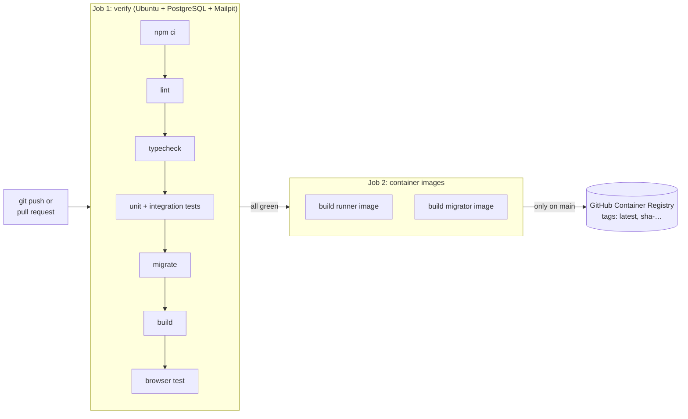

# 12. Testing and CI/CD

## Three kinds of automatic checks

| Kind | What it is | Where | How to run | Needs |
| --- | --- | --- | --- | --- |
| **Unit tests** | Check small pieces on their own: encryption, 2FA codes, recovery codes, password strength | `tests/unit/` | `npm test` | nothing |
| **Integration tests** | Check the sign-in logic against a **real** PostgreSQL test database: sign-up, verification, 2FA, recovery, resets, Google linking, rate limits, sessions | `tests/integration/` | `npm test` | `npm run services:up` |
| **End-to-end (E2E) test** | A robot Chromium browser clicks through the whole site like a person and reads the emails from Mailpit | `e2e/auth-flow.spec.ts` | `npm run test:e2e` | services up, `npm run build`, browser installed once |
| Lint | Code-quality rules | whole project | `npm run lint` | — |
| Typecheck | TypeScript finds type mistakes | whole project | `npm run typecheck` | — |

`npm test` runs 48 tests in about 25 seconds. The browser test takes 30–90 seconds.

First-time setup for the browser test:

```bash
npx playwright install chromium --only-shell   # downloads the browser to ~/.cache/ms-playwright
npm run build
npm run test:e2e                               # starts the app itself, then runs the robot
```

To run the browser test against something already running (e.g. the production containers):
`E2E_BASE_URL=http://localhost:3000 npm run test:e2e`.

### What the browser test does, in order

1. Sign up with a weak password → rejected; with a strong one → "Check your inbox".
2. Tries to sign in before verifying → refused; opens the (re-sent) email, clicks verify.
3. Signs in, turns on 2FA by scanning the setup key, saves 10 recovery codes.
4. Signs in again: wrong code → "4 attempts left"; right code → dashboard.
5. Signs in with "Use a recovery code" → 2FA is removed → security email arrives.
6. Wrong password → Forgot password → reset email → weak password rejected → strong accepted →
   "password changed" email; the old link no longer works.
7. Signs in with the new password.
8. Signs up again with the same email → same "Check your inbox" → owner gets "already have an account".
9. Fails if the browser console shows **any** error.

## CI/CD: GitHub does it on every push

Defined in `.github/workflows/ci.yml`.



- **Pull requests** run both jobs but don't publish images.
- **Pushes to `main`** also publish `ghcr.io/<owner>/<repo>` (the app) and `…-migrator` to the
  GitHub Container Registry, tagged `latest` and `sha-<commit>`.
- If the browser test fails, the **Playwright report** is attached to the run (Actions → the run →
  Artifacts) with screenshots and a step-by-step trace.
- See results on GitHub: repository → **Actions** tab. A green tick next to a commit means all checks
  passed.

The GitHub repository is currently **empty**: run `git push -u origin main` once to upload the code
and start the first CI run. GitHub asks for a username and a **personal access token** (GitHub →
Settings → Developer settings → Personal access tokens), not your password.

## Dependabot

`.github/dependabot.yml` checks weekly for updates to npm libraries, GitHub Actions and base images,
and opens a pull request for each. CI tests every one. Merge it when it's green.
