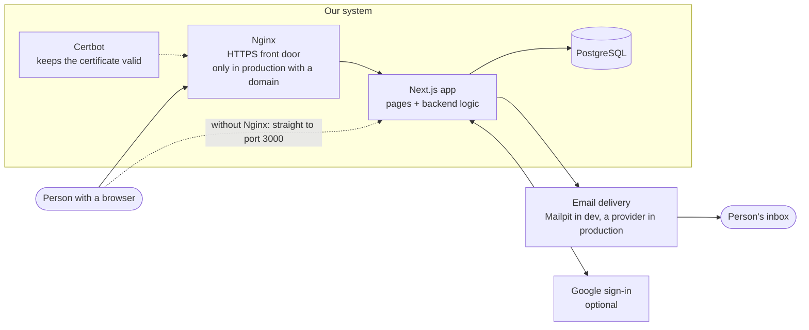
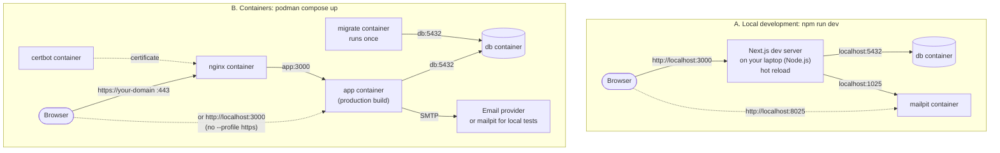
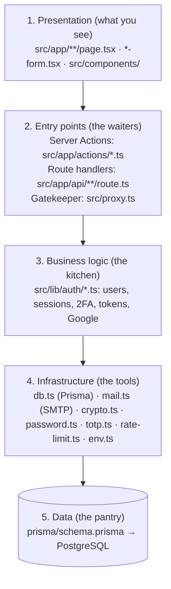
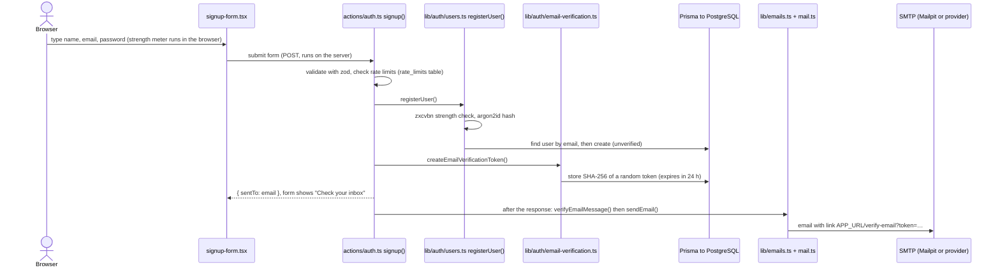
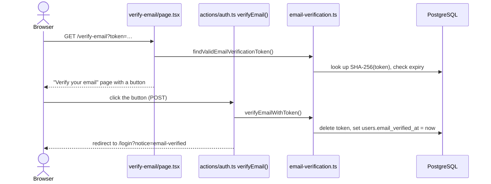
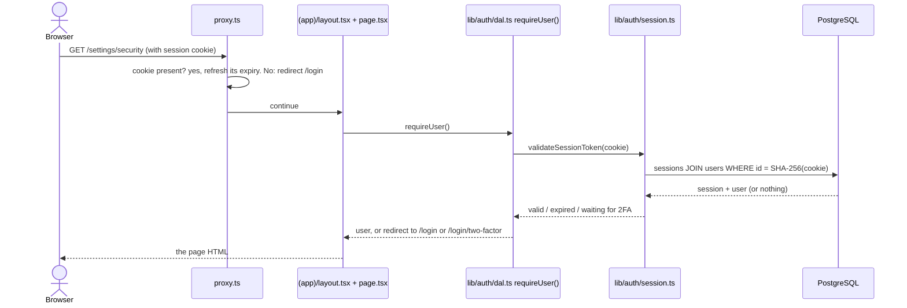

# 14. Design (high & low level), dev vs containers, and how to test

## Part 1: High-level design

### Who and what talks to the system



The **only** program with business logic is the Next.js app. Nginx just forwards encrypted traffic,
Certbot just renews the certificate, PostgreSQL just stores data, and the email service just
delivers what the app hands it.

### The same app, two ways to run it



| | A. `npm run dev` | B. Containers (`podman compose up`) |
| --- | --- | --- |
| Purpose | Changing code and seeing results instantly | Running for real (or testing exactly what production runs) |
| Where Next.js runs | On your laptop, with Node.js | Inside the `app` container |
| Build type | Development: slower, detailed errors, **hot reload** | Production: optimised, compiled once at build time |
| Code changes show up | Immediately (save the file) | Only after `podman compose up -d --build` |
| Database address | `localhost:5432` (from `DATABASE_URL`) | `db:5432` (container network) |
| Email goes to | Mailpit at `localhost:1025` → read at http://localhost:8025 | `SMTP_HOST` (a real provider), or Mailpit when `CONTAINER_SMTP_HOST=mailpit` |
| Nginx + Certbot / HTTPS | Not used | Only with `--profile https` |
| Tables created by | `npm run db:migrate` (by you) | the `migrate` container (automatically) |
| Logs appear | In the terminal running `npm run dev` | `podman compose logs -f app` |
| Containers running | 2 (`db`, `mailpit`) | 2–3 (+ `migrate`, which exits) |

Both modes use the **same database** on this laptop (`./data/postgres`). An account created in one
mode exists in the other. Only one of them can use port 3000 at a time.

### Can everything run in containers, with nothing on the laptop?

Yes. That is mode B. PostgreSQL is **never** installed on the laptop in either mode: it always runs
in the `db` container. In mode B the app runs in a container too:

```bash
podman compose --profile dev up -d --build   # db + migrate + app + mailpit, all containers
```

A machine that only **runs** the app (a server, or a colleague's PC) needs just **Podman and
podman-compose**. No Node.js, npm or PostgreSQL. Node.js on this laptop is only for *developing*:

- `npm run dev` shows code changes in about a second; a container needs a rebuild (a few minutes).
- `npm test`, `npm run test:e2e`, the Prisma CLI (`db:migrate`, `db:studio`) and the code editor's
  error checking all use the locally installed libraries.

(Running the dev server with hot reload *inside* a container is possible too, but isn't set up in
phase one.)

## Part 2: Low-level design

### Layers

The code is organised like a restaurant: waiters take orders, a kitchen follows recipes, a pantry
stores ingredients. Each layer only talks to the one below it.



Rules the code follows:

- **Pages never touch the database directly for security decisions.** They call `requireUser()`
  (`src/lib/auth/dal.ts`).
- **Business logic has no web code in it.** `src/lib/auth/*` doesn't know about cookies, redirects or
  forms, so the 48 automated tests can call it directly.
- **Secrets stay on the server.** Files marked `import "server-only"` can't be bundled into the browser.
- **Forms talk to Server Actions**, which validate input (`zod`), apply rate limits, call the logic,
  then either return a message to show or redirect.

### The project folder, file by file

```
inventory-management-system/
│
├── README.md                  Front page on GitHub (summary + links to this handbook)
├── AGENTS.md, CLAUDE.md       Notes for AI coding assistants (use the bundled Next.js 16 docs)
│
├── package.json               Library list + npm scripts (npm run dev, test, db:migrate…)
├── package-lock.json          Exact versions of every library (keeps all machines identical)
├── .nvmrc                     "24": the Node.js version CI uses
│
├── next.config.ts             Next.js settings: security headers, standalone build for containers
├── tsconfig.json              TypeScript settings (the "@/…" shortcut means src/…)
├── eslint.config.mjs          Code-quality rules
├── postcss.config.mjs         Hooks Tailwind CSS into the build
├── next-env.d.ts              Generated by Next.js (don't edit)
│
├── .env                       YOUR settings and secrets (never committed)
├── .env.example               Template for .env with explanations
├── .gitignore                 Files Git must never upload
│
├── prisma7.config.ts          Tells the Prisma CLI where the schema/migrations are
├── prisma/
│   ├── schema.prisma          The database design (tables, columns, relations)
│   └── migrations/            Numbered SQL change files, applied in order
│
├── src/                       ALL application code
│   ├── proxy.ts               Runs before every page: no session cookie → /login
│   ├── app/                   Pages, by address (folder name = URL)
│   │   ├── layout.tsx         The <html> shell around every page
│   │   ├── globals.css        Global styles (Tailwind)
│   │   ├── favicon.ico        Browser tab icon
│   │   ├── (auth)/            Signed-out pages (the "(auth)" part is not in the URL)
│   │   │   ├── layout.tsx     Centred card layout with logo
│   │   │   ├── login/         /login + two-factor/ + recovery/
│   │   │   ├── signup/        /signup
│   │   │   ├── verify-email/  /verify-email
│   │   │   ├── forgot-password/, reset-password/
│   │   ├── (app)/             Signed-in pages
│   │   │   ├── layout.tsx     Header with Dashboard, Security, name, Sign out
│   │   │   ├── page.tsx       / (the dashboard)
│   │   │   └── settings/security/  /settings/security (+ two-factor/ setup)
│   │   ├── actions/           Server Actions: auth.ts, two-factor.ts, password-reset.ts
│   │   └── api/               health/ and auth/google/ (+ callback/)
│   ├── components/            Reusable UI: auth-card, password-field, google-sign-in, ui/…
│   ├── lib/                   Logic and tools (see layers above)
│   │   └── auth/              Sessions, users, 2FA, verification, reset, Google
│   └── generated/prisma/      Auto-generated database client (never edit, not in Git)
│
├── public/robots.txt          Tells search engines not to index the app
│
├── tests/                     Automated tests (Vitest)
│   ├── unit/                  Small pieces: crypto, 2FA codes, recovery codes, password rules
│   ├── integration/           Full logic against a real test database
│   └── support/               Test setup (creates/cleans the _test database)
├── e2e/auth-flow.spec.ts      Robot-browser test of every flow (Playwright)
├── vitest.config.mts          Test runner settings
├── playwright.config.ts       Browser test settings
│
├── Dockerfile                 How to build the app and migrate images
├── .dockerignore              Files kept out of the images (secrets, data, node_modules)
├── compose.yaml               All 6 container services, ports, storage, profiles
├── docker/start.mjs           App container entry point: wait for migrations, then start
├── deploy/
│   ├── nginx/                 Nginx: entrypoint.sh + http-only / https config templates
│   └── certbot/               Certbot: certbot.sh (get + renew) + self_signed.py (localhost tests)
├── scripts/                   init-env.sh, backup-db.sh, restore-db.sh
│
├── .github/
│   ├── workflows/ci.yml       What GitHub runs on every push
│   └── dependabot.yml         Weekly library-update pull requests
│
├── docs/                      This handbook (+ screenshots/)
│
└── (created automatically, ignored by Git)
    ├── node_modules/          Downloaded libraries (npm install)
    ├── .next/                 Build output (npm run dev / build)
    ├── data/postgres/         Database files (POSTGRES_DATA_DIR)
    ├── backups/               Database dumps (backup-db.sh)
    └── test-results/, playwright-report/   Browser-test output
```

### One request, file by file: signing up



Then, when the link is clicked:



### One request, file by file: opening a private page



## Part 3: Where Nginx and Certbot come in

- They are **not** part of `npm run dev`, and **not** started by a plain `podman compose up`. They
  start **only** with `--profile https`.
- They are for **production with a real domain**, because:
  1. HTTPS (the padlock) needs a certificate. **Certbot** gets free Let's Encrypt certificates and
     renews them; **Nginx** uses them to encrypt traffic.
  2. Google sign-in only accepts `https://` addresses (except `localhost`).
  3. Secure cookies and HSTS require HTTPS.
- Traffic: browser → **Nginx :443 (encrypted)** → `app:3000` (plain, inside the private container
  network) → `db:5432`.
- Configuration: `deploy/nginx/` (templates + start script) and `deploy/certbot/` (get/renew script).
  [Chapter 8](08-networking-domain-https.md#how-lets-encrypt-works-here) explains every line.
- (Phase one first used Caddy for this; it was replaced by Nginx + Certbot on request.)

On a laptop there is no public domain. With `DOMAIN=localhost`, Certbot creates a **self-signed**
certificate instead, which browsers show a warning for. That's useful to test the setup (Part 5,
test C), not for daily use.

## Part 4: What happens to email verification

**It works, but in development the emails never reach real inboxes.** They are caught by Mailpit.

| Mode | Where the verification email goes | Where you read it |
| --- | --- | --- |
| `npm run dev` | Mailpit (`SMTP_HOST=localhost`, port 1025) | http://localhost:8025 |
| Containers on the laptop with `CONTAINER_SMTP_HOST=mailpit` | Mailpit | http://localhost:8025 |
| Production with a real provider in `SMTP_*` | the person's real inbox | Gmail, Outlook… |

So if you sign up with your Gmail address during development, **nothing arrives in Gmail**: open
http://localhost:8025 instead. To get real emails, put a provider's SMTP settings in `.env`
([chapter 10](10-operations.md#email-providers)).

Also good to know:

- **Your two existing accounts** were created on day one, before verification existed. The
  day-two migration marked every existing account as verified, so they never needed an email.
- **Mailpit forgets emails when its container is recreated** (it keeps them in memory). That's fine
  for a test inbox.
- Emails are sent **after** the page responds (usually within a second). If Mailpit is empty, wait a
  moment and refresh. In `npm run dev`, a send failure is logged in the terminal as
  `[email] failed to send …`.
- Signing in before verifying sends a **new** link and cancels the older one: always use the newest
  email.

## Part 5: How to test the web app

### Test A: development mode (`npm run dev`)

```bash
cd ~/Projects/inventory-management-system
podman compose --profile https stop app nginx certbot 2>/dev/null   # free port 3000 if containers run
npm run services:up                         # db + mailpit
npm run dev                                 # wait for "Ready", then open http://localhost:3000
```

Keep three browser tabs open: **the app** (http://localhost:3000), **Mailpit**
(http://localhost:8025), and optionally **the database** (`npm run db:studio` in a second terminal
→ http://localhost:5555).

### Test B: the real production containers (`podman compose up`)

```bash
cd ~/Projects/inventory-management-system
# stop `npm run dev` first (Ctrl+C in its terminal), port 3000 must be free
grep CONTAINER_SMTP_HOST .env                    # must say mailpit for local testing
podman compose --profile dev up -d --build       # db + migrate + app + mailpit (first build: 5–10 min)
podman compose ps                                # wait until app is "healthy"
podman compose logs -f app                       # watch the app (Ctrl+C to stop watching)
```

Open http://localhost:3000 and http://localhost:8025 as in test A. When done, return to development
mode with `podman compose stop app` (then `npm run dev`).

### Test C: through Nginx with HTTPS (optional, local)

```bash
APP_URL=https://localhost:8443 DOMAIN=localhost HTTP_PORT=8080 HTTPS_PORT=8443 \
  podman compose --profile dev --profile https up -d --build
podman compose --profile https logs certbot    # "created a self-signed certificate for localhost"
podman compose --profile https logs nginx      # within 30 s: "reloaded (https mode)"
```

Open https://localhost:8443. The browser warns that the certificate isn't trusted (it's self-signed
for `localhost`): choose *Advanced → Continue*. Email links now point to port 8443.
`curl -I http://localhost:8080/login` shows the HTTP→HTTPS redirect (`301`, to the standard port 443,
which is what a real server uses; locally, keep using 8443). Afterwards run
`podman compose --profile https stop nginx certbot` and `podman compose up -d app` (without the
overrides) to go back. Nginx and Certbot are part of the `https` profile, so commands that name them
need `--profile https`.

### What to try (manual test checklist)

| # | Do this | Expected | Also check |
| --- | --- | --- | --- |
| 1 | Sign up with password `password123` | Rejected with tips; meter shows "Weak" | — |
| 2 | Sign up with a long passphrase | "Check your inbox" | Mailpit: "Verify your email for Inventory" |
| 3 | Sign in before clicking the link | "Please verify your email address first" | Mailpit: a second verification email |
| 4 | Open the **newest** email → button → Verify | "Your email is verified. Sign in" | DB: `users.email_verified_at` filled |
| 5 | Sign in | Dashboard: "Welcome, <name>" | DB: a row in `sessions` |
| 6 | Dashboard → Turn on 2FA → scan QR with your phone → enter code | "Two-factor authentication is on" + 10 codes | Save the codes |
| 7 | Sign out, sign in, enter `000000` | "That code didn't work. 4 attempts left." | — |
| 8 | Enter the real code from the phone | Dashboard | — |
| 9 | Sign out, sign in → "Use a recovery code" → enter one saved code | Dashboard: "Two-factor authentication has been removed from your account." | Mailpit: "Two-factor authentication was turned off" |
| 10 | Sign out → wrong password | "Incorrect email or password" + Forgot link | — |
| 11 | Forgot password → your email | "If an account exists…" | Mailpit: "Reset your Inventory password" |
| 12 | Open reset link → weak password | Rejected, stays on the page | — |
| 13 | Strong new password | "Your password has been changed" | Mailpit: "…password was changed" |
| 14 | Open the same reset link again | "This link has expired" | — |
| 15 | Sign up again with the same email | "Check your inbox" (same answer) | Mailpit: "You already have an Inventory account" |
| 16 | Try 11 wrong passwords in a row | "Too many sign-in attempts…" | DB: `rate_limits` rows |

### Automated tests (the computer checks everything)

```bash
npm test                                  # 48 checks, ~25 s (needs npm run services:up)
npm run build && npm run test:e2e         # robot browser runs the checklist above, ~1 min
E2E_BASE_URL=http://localhost:3000 npm run test:e2e   # same, against whatever runs on 3000 (dev or container)
```

(First time only: `npx playwright install chromium --only-shell`.)

### Watching the database while testing

```bash
npm run db:studio        # spreadsheet view at http://localhost:5555 (development machine)
# or, in any mode:
podman exec -it inventory-management-system_db_1 psql -U inventory -d inventory \
  -c "SELECT email, email_verified_at IS NOT NULL AS verified, totp_enabled_at IS NOT NULL AS has_2fa FROM users;"
```

Test accounts end up in the same database as your real ones. Delete them afterwards with the admin
recipes in [chapter 6](06-database-and-prisma.md#admin-recipes-for-support-situations).
